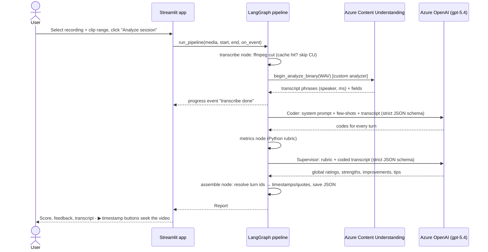
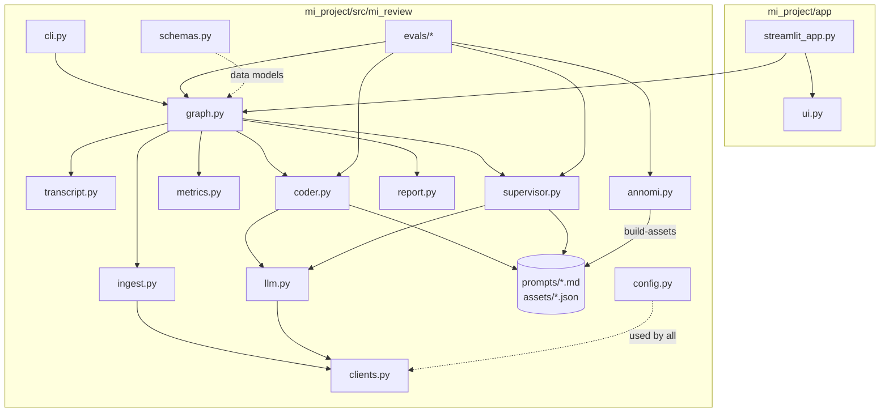
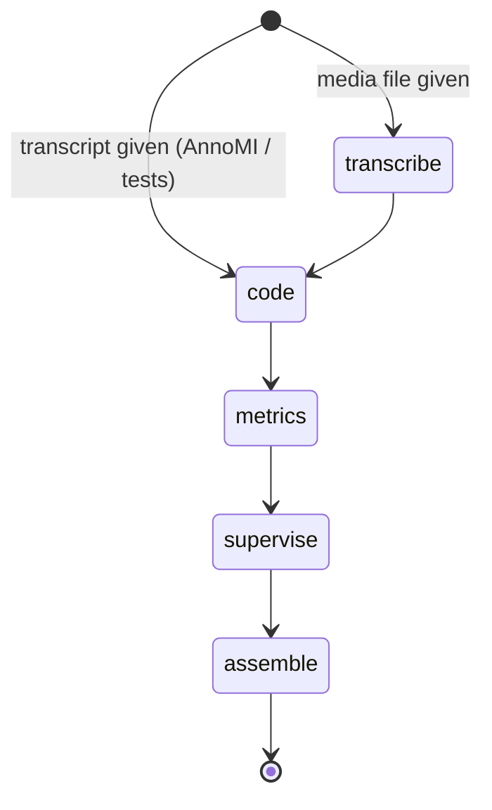

# MI Review Coach

**AI review of Motivational Interviewing (MI) sessions.** Upload a recorded counselling session (video or audio). The app transcribes it, separates the clinician from the client, codes every turn using MI research standards (MITI 4.2.1 / AnnoMI), scores the session against an MI proficiency rubric, and gives timestamped coaching feedback: what went well, what to improve, and what the clinician could have said instead.

Built with **Azure Content Understanding**, **Azure OpenAI in Microsoft Foundry (gpt-5.4)**, **LangGraph**, **Pydantic** and **Streamlit**.

---

## Contents

1. [What it does](#1-what-it-does)
2. [Architecture](#2-architecture)
3. [Repository layout](#3-repository-layout)
4. [Setup (new machine)](#4-setup-new-machine)
5. [Using your own Azure resources](#5-using-your-own-azure-resources)
6. [Running the app and the CLI](#6-running-the-app-and-the-cli)
7. [How the pipeline works (deep dive)](#7-how-the-pipeline-works-deep-dive)
8. [Unit tests](#8-unit-tests)
9. [Evaluations (quality measurement)](#9-evaluations-quality-measurement)
10. [Results so far](#10-results-so-far)
11. [How to modify things (recipes)](#11-how-to-modify-things-recipes)
12. [Configuration reference](#12-configuration-reference)
13. [Troubleshooting](#13-troubleshooting)
14. [Sharing the project](#14-sharing-the-project)
15. [Known limitations and roadmap](#15-known-limitations-and-roadmap)
16. [Glossary and references](#16-glossary-and-references)

---

## 1. What it does

| Input | Output |
|---|---|
| A video or audio recording of a clinician–client conversation (mp4, mov, m4a, mp3, wav, …), with an optional start/end time to skip intros | An interactive report: MI proficiency score (0–12), Empathy and Collaboration ratings, change talk ratio, timestamped strengths and traps with suggested better responses, a coded transcript, session dynamics charts, and token/latency usage |

### The scoring rubric

The rubric comes from `mi_project/prelimnary_plans/mi_approach_document.md`: **6 metrics, a proficiency score, and a client impact metric**.

| # | Metric | How it is measured | Basic (1 pt) | Advanced (2 pts) |
|---|---|---|---|---|
| 1 | Empathy (1–5) | Supervisor LLM, MITI 4.2.1 anchors, half-point scale | ≥ 3.5 | ≥ 4.0 |
| 2 | Collaboration (1–5) | Supervisor LLM, MITI 4.2.1 "Partnership" anchors | ≥ 3.5 | ≥ 4.0 |
| 3 | Reflection-to-question ratio | Computed in Python from turn codes | ≥ 1.0 | ≥ 2.0 |
| 4 | % open questions | Computed in Python | > 40% | > 50% |
| 5 | % complex reflections | Computed in Python | > 40% | > 50% |
| 6 | % MI-adherent | adherent / (adherent + non-adherent) turns | ≥ 90% | 100% |
| ★ | **MI proficiency score** | Sum of points | 7–9 = Basic proficiency | 10–12 = Advanced (0–6 = Developing) |
| ◆ | **Change talk ratio** | change / (change + sustain) client turns | Client-impact indicator, no points | |

> **Why half-points for Empathy and Collaboration?** With whole-number scores, the 3.5 Basic threshold can never be met, so Basic and Advanced would collapse into one level.

---

## 2. Architecture

### Pipeline overview

```mermaid
flowchart LR
    A[Video / audio file] -->|ffmpeg: cut clip,<br/>16 kHz mono WAV| B(Azure Content Understanding<br/>custom analyzer 'miSessionAudio')
    B -->|diarized phrases + timestamps<br/>+ TargetBehavior, ClinicianSpeaker, Summary| C[Transcript builder<br/>phrases → turns, roles]
    C --> D[[Coder agent<br/>gpt-5.4 · low effort]]
    D -->|AnnoMI/MITI codes per turn| E[Metrics<br/>deterministic Python]
    E --> F[[Supervisor agent<br/>gpt-5.4 · medium effort]]
    F -->|Empathy, Collaboration,<br/>strengths, traps, tips| G[Report builder<br/>turn ids → timestamps + quotes]
    G --> H[(Report JSON)]
    H --> I((Streamlit UI))

    classDef azure fill:#0078D4,stroke:#fff,color:#fff;
    classDef agent fill:#0d9488,stroke:#fff,color:#fff;
    class B azure;
    class D,F agent;
```



- **Two LLM calls per session.** The Coder labels turns; the Supervisor judges and gives feedback.
- **Deterministic code in between.** All ratios and thresholds are computed in Python, never by the LLM.
- **Grounded citations.** The Supervisor cites turn ids only; Python inserts the verbatim quote and timestamp, so the LLM cannot invent quotes or timestamps.

### Request sequence (one analysis from the UI)



### Module map



### Key design decisions (and why)

| Decision | Reason |
|---|---|
| Local **ffmpeg** cut instead of CU's `content_range` | CU ignored `content_range` for binary uploads: timestamps came back measured from the start of the file and the whole file was billed. Cutting locally to a 16 kHz mono WAV also halves CU time (89 s → ~35 s). |
| CU **custom analyzer** with 3 generated fields | One CU pass gives the transcript plus `ClinicianSpeaker` (maps Speaker 1/2 to roles), `TargetBehavior` (needed to judge change vs sustain talk) and `SessionSummary`. |
| Code **per turn**, not per sentence | Matches AnnoMI labels and MITI's rule of one question code per turn (volley). Consecutive phrases from the same speaker are merged. |
| Coder output **mirrors AnnoMI-full columns** | Lets us measure the Coder directly against expert labels. |
| Evaluator + synthesis merged into one **Supervisor** call | The two jobs shared the same input; a single strictly typed call is cheaper and simpler. |
| **Pydantic** schemas + strict JSON-schema structured outputs | The model can only return valid, typed objects; Python validators enforce business rules (every turn coded once, citations exist, codes consistent). |
| `responses.create` + `model_validate_json(output_text)` | The SDK's `responses.parse` fails when gpt-5.4 splits its JSON across several output chunks. |
| Few-shot examples from **at most 2 AnnoMI transcripts** | Keeps the prompt small (~1.4k tokens) while covering all 15 labels. The rest of AnnoMI is used only for offline evaluation, never in prompts. |
| Static prompt first, transcript last | Azure OpenAI prompt caching: about 75–85% of input tokens are cached on repeat calls. |
| gpt-5.4 for the Coder (not mini) | It beat gpt-5.4-mini clearly on the codes the rubric depends on (κ 0.86 vs 0.76 for main behaviour, 0.68 vs 0.55 for reflection type). |

---

## 3. Repository layout

```text
ADI/                                   ← repository root (run all commands from here)
├── pyproject.toml                     ← uv workspace root (also deps for the old notebooks in junk/)
├── uv.lock                            ← pinned versions for every package
├── .python-version                    ← 3.13 (uv installs it automatically)
├── .env.sample                        ← copy to .env and fill in your Azure details
├── AnnoMI/
│   ├── AnnoMI-full.csv                ← expert-annotated MI transcripts (needed for tests, evals, build-assets)
│   ├── AnnoMI-simple.csv
│   └── AnnoMI_EDA.ipynb               ← exploratory analysis of the dataset
├── junk/                              ← earlier Content Understanding / AI Search notebooks (not used by the app)
└── mi_project/
    ├── pyproject.toml                 ← the `mi-review` package (uv workspace member)
    ├── prelimnary_plans/              ← research and approach documents
    ├── app/
    │   ├── streamlit_app.py           ← Streamlit UI (page script)
    │   ├── ui.py                      ← UI helpers: cards, charts, captions, seek buttons
    │   └── .streamlit/config.toml     ← theme (teal) and upload size limit
    ├── data/                          ← put recordings here (git-ignored)
    │   ├── *.mp4                      ← sample videos (shared separately)
    │   ├── uploads/                   ← files uploaded through the UI (hashed names)
    │   └── output/
    │       ├── cu/                    ← cached Content Understanding results
    │       ├── reports/               ← saved report JSONs (openable in the UI without Azure)
    │       └── eval/                  ← evaluation predictions and summaries
    ├── src/mi_review/
    │   ├── config.py                  ← paths + all settings from environment variables
    │   ├── clients.py                 ← Azure clients (Entra ID or API key; optional proxy TLS fix)
    │   ├── llm.py                     ← structured-output LLM call with retries + usage capture
    │   ├── schemas.py                 ← shared data models (Phrase, Turn, Transcript, usage)
    │   ├── ingest.py                  ← CU analyzer definition, setup, transcription, caching
    │   ├── transcript.py              ← phrases → turns, speaker → role mapping
    │   ├── coder.py                   ← Coder agent (per-turn codes)
    │   ├── metrics.py                 ← the rubric: counts, 6 metrics, 0–12 score, bands
    │   ├── supervisor.py              ← Supervisor agent (globals, strengths, traps, tips)
    │   ├── report.py                  ← final Report model; resolves turn ids → quotes/timestamps
    │   ├── graph.py                   ← LangGraph pipeline + run_pipeline() entry point
    │   ├── annomi.py                  ← AnnoMI loader, gold metrics, builds the assets/
    │   ├── cli.py                     ← `mi-review` command-line interface
    │   ├── prompts/
    │   │   ├── coder_system.md        ← Coder rules (MITI 4.2.1 / AnnoMI); {fewshot} placeholder
    │   │   └── supervisor_system.md   ← Supervisor rubric anchors, trap catalogue; {anchors} placeholder
    │   ├── assets/                    ← generated by `mi-review build-assets` (committed)
    │   │   ├── fewshot_coder.json     ← 22 labelled example turns (from AnnoMI 60 + 131)
    │   │   ├── supervisor_anchors.json← one high- and one low-quality excerpt
    │   │   ├── eval_split.json        ← held-out transcript ids for evaluation
    │   │   └── benchmarks.json        ← AnnoMI medians for high vs low quality (shown in the UI)
    │   └── evals/
    │       ├── eval_coder.py          ← Coder vs expert labels
    │       ├── eval_supervisor.py     ← scores vs expert high/low quality
    │       └── eval_ingest.py         ← full audio pipeline vs the expert transcript of the same video
    └── tests/                         ← offline unit tests (no Azure calls)
```

---

## 4. Setup (new machine)

### 4.1 Prerequisites

| Tool | Why | Install |
|---|---|---|
| **uv** | Python + dependency manager | Windows: `powershell -ExecutionPolicy ByPass -c "irm https://astral.sh/uv/install.ps1 \| iex"` · macOS/Linux: `curl -LsSf https://astral.sh/uv/install.sh \| sh` |
| **ffmpeg** | Cuts the clip and converts it to WAV before transcription | Windows: `winget install Gyan.FFmpeg` · macOS: `brew install ffmpeg` · Ubuntu: `sudo apt install ffmpeg` |
| **Azure CLI** (only for Entra ID auth) | `az login` provides your identity to the SDKs | <https://learn.microsoft.com/cli/azure/install-azure-cli> |
| **Microsoft Foundry resource** | Content Understanding + Azure OpenAI deployments | See [section 5](#5-using-your-own-azure-resources) |

Python 3.13 is installed automatically by uv (pinned in `.python-version`). Without ffmpeg the app still works, but it sends the whole file to CU (you are billed for all of it) and filters the clip afterwards.

### 4.2 Install and configure

```powershell
# 1. Get the code, then from the repository root:
cd ADI

# 2. Create .venv (Python 3.13) and install everything, including the mi-review package (editable)
uv sync

# 3. Configure your Azure details
copy .env.sample .env          # macOS/Linux: cp .env.sample .env
#    then edit .env (endpoints + deployment names; see section 5)

# 4. Sign in (skip if you use API keys in .env)
az login

# 5. Create the CU model mapping and the custom analyzer (safe to re-run)
uv run mi-review setup-analyzer

# 6. Check everything: env, auth, CU, both model deployments
uv run mi-review doctor
```

A healthy `doctor` output looks like this:

```text
Checks:
  OK   Entra ID token (az login) (16.0s)
  OK   CU prebuilt-audio analyzer (4.7s) - prebuilt-audio
  OK   CU model deployment defaults (2.6s) - gpt-5.4-mini -> gpt-5.4-mini
  OK   CU custom analyzer (2.7s) - miSessionAudio base=prebuilt-audio
  OK   Structured output: gpt-5.4 (6.4s) - in=65 out=17 reasoning=0
  OK   Structured output: gpt-5.4 (4.1s) - in=65 out=32 reasoning=13
```

### 4.3 Add sample recordings

Recordings are not in git (size and copyright). Put them in `mi_project/data/`:

| File name (exact, so the UI presets apply) | Source | Clip to analyse |
|---|---|---|
| `Motivational Interviewing in Action_ Role Play - (480p).mp4` | YouTube "Motivational Interviewing in Action: Role Play" (high-quality MI) | 39 s – 223 s (narrator intro/outro excluded) |
| `annomi_video_27.mp4` | <https://www.youtube.com/watch?v=kN7T-cmb_l0> (AnnoMI transcript 27, low-quality MI) | whole file |

Any other recording works through **Upload** in the UI or `--media` on the CLI.

### 4.4 VS Code / Jupyter

Select the interpreter `.venv\Scripts\python.exe` (macOS/Linux: `.venv/bin/python`). Notebooks can `import mi_review` directly because the package is installed in editable mode.

---

## 5. Using your own Azure resources

Everything Azure-specific lives in `.env`. To point the app at a different Foundry resource:

1. **Create or choose a Foundry resource** (Azure AI Services) in a region where Content Understanding is available.
2. **Deploy two models** in that resource (any deployment names you like):
   - a premium reasoning model (recommended **gpt-5.4**) for the Coder and Supervisor agents;
   - a small model (recommended **gpt-5.4-mini**) that Content Understanding uses to fill the analyzer fields.
3. **Give yourself access:** for Entra ID auth, assign the **Cognitive Services User** role on the resource to your account. Alternatively, use API keys.
4. **Edit `.env`:**

   ```dotenv
   CONTENTUNDERSTANDING_ENDPOINT=https://<resource>.services.ai.azure.com/
   AZURE_OPENAI_ENDPOINT=https://<resource>.openai.azure.com/
   AZURE_OPENAI_PREMIUM_DEPLOYMENT=<your gpt-5.4 deployment name>
   AZURE_OPENAI_CHAT_DEPLOYMENT=<your gpt-5.4-mini deployment name>
   CU_COMPLETION_MODEL=gpt-5.4-mini           # the MODEL name behind that mini deployment
   # Optional instead of az login:
   # CONTENTUNDERSTANDING_API_KEY=...
   # AZURE_OPENAI_API_KEY=...
   ```

5. Run `uv run mi-review setup-analyzer`, then `uv run mi-review doctor`.

**Notes**

- `setup-analyzer` maps CU's model name to your deployment. This is a **resource-wide** CU setting, and existing mappings are kept. It then creates the `miSessionAudio` analyzer if it does not exist.
- **Other models:** the agents need the Responses API with strict JSON-schema structured outputs. For a non-reasoning model (for example gpt-4.1), set `MI_CODER_EFFORT=none` and `MI_SUPERVISOR_EFFORT=none`. Re-run the evaluations (section 9) after changing models.
- **Corporate TLS proxies** (for example Netskope or Zscaler) can cause `CERTIFICATE_VERIFY_FAILED`. Set `MI_RELAX_X509_STRICT=1`; it trusts `REQUESTS_CA_BUNDLE` and relaxes Python 3.13's strict X.509 check.

---

## 6. Running the app and the CLI

### 6.1 Streamlit app

```powershell
uv run streamlit run mi_project/app/streamlit_app.py
```

Open <http://localhost:8501>.

- **Sidebar → Source**
  - **Sample:** pick a file from `mi_project/data/`; the clip range is preset for the known samples.
  - **Upload:** your own recording (≤ 300 MB).
  - **Saved report:** opens a previous analysis instantly, with **no Azure calls**. This is a good fallback for demos.
- **Analyze session** runs the pipeline with live progress. Expect about 60–80 s when the transcript is cached, and 100–120 s for a new recording.
- **Report**
  - Video player with an optional *Captions* track built from the transcript.
  - Score panel, then five tabs: **Feedback** (▶ buttons jump the video to the cited moment), **Scorecard**, **Transcript** (filters and code badges), **Session dynamics**, and **Run details** (tokens, timings, warnings, JSON download).

### 6.2 Command line (`uv run mi-review <command>`)

| Command | What it does | Azure? |
|---|---|---|
| `doctor` | Checks settings, auth, CU analyzer and mapping, and both deployments | yes (tiny) |
| `setup-analyzer [--replace]` | Sets the CU model mapping; creates (or recreates) the custom analyzer | yes |
| `transcribe <file> [--start S --end S]` | CU only: prints fields, speaker roles and the first turns | CU |
| `code --media <file> \| --annomi <id>` | Runs the Coder; prints codes (with expert labels for AnnoMI) and metrics | OpenAI |
| `run --media <file> [--start --end] \| --annomi <id>` | **Full pipeline**; prints the report and saves JSON to `data/output/reports/` | yes |
| `build-assets` | Rebuilds few-shot examples, anchors, eval split and benchmarks from AnnoMI | no |
| `eval-coder [--model --effort --ids …]` | Coder vs expert labels on held-out AnnoMI transcripts | OpenAI |
| `eval-supervisor [--ids …]` | Do the scores separate expert-rated high vs low sessions? | OpenAI |
| `eval-ingest [--media --annomi]` | Full audio pipeline vs the expert transcript of the same video | yes |

Examples:

```powershell
uv run mi-review run --media "mi_project/data/Motivational Interviewing in Action_ Role Play - (480p).mp4" --start 39 --end 223
uv run mi-review run --annomi 27            # skips CU: uses the AnnoMI expert transcript text
```

Run commands from the repository root: default paths such as `mi_project/data/...` are relative to it.

---

## 7. How the pipeline works (deep dive)

The pipeline is a LangGraph `StateGraph` (`graph.py`). Each node is wrapped by `_stage(...)`, which emits `start`/`done` progress events (shown by the CLI and Streamlit) and records how long the stage took.



### 7.1 `transcribe`: `ingest.py` + `transcript.py`

1. **Cut the clip:** `ffmpeg -ss start -to end` produces a 16 kHz mono WAV. Phrase times are then shifted back to original media time (absolute).
2. **Analyze:** CU analyzer `miSessionAudio` (base `prebuilt-audio`, `returnDetails`, `locales=en-US`) returns `transcript_phrases` (speaker, start/end ms, text) and three generated fields:
   - `ClinicianSpeaker` (classify: Speaker 1–4),
   - `TargetBehavior` (the desired *new* behaviour),
   - `SessionSummary`.
3. **Cache:** the raw result is saved to `data/output/cu/<filehash>.<analyzer>.<method>.<start>_<end>.json`. Re-runs on the same clip skip CU.
4. **Roles:** the clinician is the CU `ClinicianSpeaker` value. It is cross-checked against a heuristic (the speaker who asks the most questions); a disagreement or more than 2 speakers produces a warning.
5. **Turns:** consecutive phrases with the same role are merged into one turn (`Turn`: id, role, start/end ms, text).

### 7.2 `code`: `coder.py` (Coder agent)

- **Prompt:** `prompts/coder_system.md` (MITI 4.2.1 / AnnoMI rules) plus 22 few-shot examples rendered from `assets/fewshot_coder.json`. The input is the target behaviour and the numbered transcript (`[T12] CLIENT: …`).
- **Output schema** (`CoderOutput`, strict JSON):

  | Speaker | Fields |
  |---|---|
  | Therapist turn | `rationale` (≤ 15 words), `reflection` (none/simple/complex), `question` (none/open/closed), `therapist_input` (none/information/advice/negotiation/options), `main_behaviour`, `mi_behaviour` (affirm, seek_collaboration, emphasize_autonomy, persuade_with_permission, persuade, confront, none), `adherence` (adherent/non_adherent/neutral) |
  | Client turn | `rationale`, `talk_type` (change/sustain/neutral) |

- **Python checks after the call:**
  - every turn is coded exactly once and matches the speaker's role;
  - missing turns are re-requested once, then filled with a neutral default and a warning;
  - codes are made internally consistent (e.g. main=reflection requires a reflection; persuade/confront ⇒ non-adherent).
- **Long transcripts:** above 120 turns, the transcript is coded in 80-turn windows with 10 turns of context.

### 7.3 `metrics`: `metrics.py`

- Converts codes to `TurnLabels` and counts at most one question and one reflection per therapist turn (MITI).
- Computes the 6 metrics, levels, points and band.
- **Edge cases:**
  - with no questions, R:Q uses the reflection count;
  - any other undefined metric is marked `insufficient_data` and scores 0 points;
  - Empathy and Collaboration stay `pending` until the Supervisor has run.
- The same functions compute metrics from AnnoMI expert labels (`labels_from_gold`), which keeps evaluations consistent.

### 7.4 `supervise`: `supervisor.py` (Supervisor agent)

- **Prompt:** `prompts/supervisor_system.md`, containing:
  - MITI 4.2.1 anchors for Empathy and Partnership (half-point scale);
  - the trap catalogue (expert, question–answer, confrontation–denial, premature focus, labeling, blaming, persuasion without permission, missed change talk, missed reflection);
  - strength types;
  - two calibration excerpts from `assets/supervisor_anchors.json`.
- **Input:** the deterministic metrics plus the coded transcript.
- **Output** (`SupervisorOutput`):
  - Empathy and Collaboration, each with justification and evidence turn ids;
  - 1–3 strengths;
  - 1–3 improvements, each with a `better_response` written in the clinician's voice;
  - overall summary and coaching tips.
- **Citation check (`_check`):** citations to turns that don't exist are dropped, and each feedback item must lead with a therapist turn.

### 7.5 `assemble`: `report.py`

- Recomputes the rubric with Empathy and Collaboration filled in.
- Resolves every cited turn id to `Evidence` (timestamp and verbatim quote). Any `[T12]` or `T12` mentions in the prose become `[mm:ss]`.
- Adds usage (CU audio hours, every LLM call's tokens including cached and reasoning tokens, time per stage, total time).
- Saves `data/output/reports/<session_id>.json`. This is exactly what the UI renders.

### 7.6 Shared helpers

- `llm.structured_call(...)` is the single place where LLM calls happen. It sends a Pydantic schema as a strict JSON schema, validates the reply, retries once on invalid output, and returns `(object, LLMUsage)`.
- `clients.py` builds cached Azure clients. It uses an API key if one is set in `.env`; otherwise `DefaultAzureCredential` (az login).

### 7.7 Caches and how to invalidate them

| Cache | Location | Key | Clear when… |
|---|---|---|---|
| CU results | `data/output/cu/` | file hash + analyzer id + clip range | you change the analyzer definition (`ingest.FIELD_SCHEMA`); delete the files or use `transcribe --no-cache` |
| Reports | `data/output/reports/` | session id (file name + hash + range) | each run overwrites its report |
| Eval predictions | `data/output/eval/<agent>/<model>_<effort>_<prompthash>/` | model + effort + **hash of the prompt** | automatic: editing a prompt creates a new folder |

---

## 8. Unit tests

```powershell
cd mi_project
uv run pytest -q            # 31 tests, ~1 min, no Azure calls, no cost
uv run pytest -q tests/test_metrics.py -k thresholds    # one file / one test
cd ..
```

| Test file | What it protects |
|---|---|
| `test_transcript.py` | Merging phrases into turns, sorting, role mapping (CU hint, question heuristic, disagreement and >2-speaker warnings) |
| `test_annomi.py` | AnnoMI loader (transcript 27 with 10-annotator majority labels), role/label consistency, the multi-annotator set, gold metrics, **no leakage** between few-shot and evaluation transcripts |
| `test_metrics.py` | The rubric: the approach document's worked example, every threshold edge (≥ vs >), bands, edge cases, and agreement with AnnoMI gold metrics |
| `test_coder.py` | Prompt rendering (few-shots inserted, CONTEXT marking), consistency fixes, windowing, codes → labels |
| `test_report.py` | Citation filtering (invalid ids dropped, therapist turn first), timestamp/quote resolution, `[T12]`/`T12` → `[mm:ss]`, usage totals |
| `test_graph.py` | The LangGraph pipeline with **stubbed agents**: CU skipped for text input, progress events in order, report fields, usage |
| `test_app.py` | Streamlit `AppTest` (headless): empty state renders; a report renders; a ▶ button sets the seek time |

Run the tests after every code change. They take about a minute and cost nothing.

---

## 9. Evaluations (quality measurement)

Unit tests check that the **code** is correct. Evaluations measure whether the **AI judgements** are good, by comparing them with expert human labels from the AnnoMI dataset. They call Azure OpenAI, so they cost tokens; predictions are cached, so re-running analysis on the same prompt and model is free.

### 9.1 The data split (`assets/eval_split.json`)

| Group | Transcripts | Purpose |
|---|---|---|
| Few-shot source | 60 (high), 131 (low) | The only transcripts that appear in prompts; excluded from evaluation |
| Stratified sample | 20 (12 high + 8 low, fixed seed) | Main test set, balanced so that low-quality sessions are well represented (the dataset has 110 high vs 23 low) |
| Multi-annotator | 7, 27, 55, 56, 66, 109, 130 | Each labelled independently by 10 experts. We use their **majority vote** as the reference, and their agreement with each other as the **human ceiling** |
| Reserved gold video | 27 | We have its video, so it is used for the end-to-end audio test; it is never a few-shot example |

### 9.2 `eval-coder`: are the turn codes right?

```powershell
uv run mi-review eval-coder                          # 27 transcripts, default model
uv run mi-review eval-coder --model gpt-5.4-mini --effort low
```

The Coder runs on the expert transcript **text** (no CU), and every turn is compared with the expert label. The output includes:

- **Accuracy**: share of turns labelled the same as the expert.
- **Macro-F1**: F1 averaged over labels, so rare labels (sustain talk, advice) count as much as common ones.
- **Cohen's κ (kappa)**: agreement corrected for chance (0 = chance, 0.4–0.6 moderate, 0.6–0.8 substantial, 1 = perfect). Accuracy alone can mislead: always answering "neutral" would score 60% accuracy but κ = 0.
- **Confusion matrix**: rows are the expert label, columns the model label; off-diagonal cells show which labels get mixed up. This is how prompts are tuned.
- **Human ceiling**: κ of each expert against the majority of the other 9. A model near this level is as consistent as the experts are with each other.
- **Session-level**: MAE and Spearman correlation of R:Q, %OQ, %CR and change talk ratio (predicted vs expert labels), and their AUC for high vs low quality.

Output files: `data/output/eval/coder/<tag>/summary.json`, `turns.csv`, `transcripts.csv`.

### 9.3 `eval-supervisor`: do the scores separate good from poor MI?

```powershell
uv run mi-review eval-supervisor
```

AnnoMI has no expert Empathy or Collaboration numbers, only a high/low quality label per session. This evaluation checks:

- **AUC**: the probability that a random high-quality session scores higher than a random low-quality one (1.0 = perfect, 0.5 = coin flip). Reported for the proficiency score, Empathy, Collaboration and their mean.
- Mean score and band distribution by quality.
- **Citation validity**: share of cited turn ids that are real.
- **Stability**: 3 sessions are re-run and the score differences reported.
- Trap types found in high vs low sessions, plus latency and tokens.

### 9.4 `eval-ingest`: does the audio front end work?

```powershell
uv run mi-review eval-ingest        # default: mi_project/data/annomi_video_27.mp4 vs AnnoMI 27
```

The full pipeline runs on the real video and is compared with the expert transcript of the same video:

- **WER** (word error rate of the transcription);
- **speaker-role accuracy** (word-weighted);
- the share of expert utterances matched to transcribed turns;
- tag agreement on matched turns;
- session metrics from expert labels vs the audio pipeline.

---

## 10. Results so far

### Coder (27 held-out transcripts, 644 therapist and 632 client turns)

| Label | gpt-5.4-mini κ | **gpt-5.4 κ (default)** | Human ceiling κ |
|---|---|---|---|
| Main behaviour | 0.76 | **0.86** | 0.81 |
| Reflection none/simple/complex | 0.55 | **0.68** | 0.57 |
| Question none/open/closed | 0.77 | **0.77** | 0.80 |
| Client change/sustain/neutral | 0.61 | **0.66** | 0.58 |
| Seconds per session | 19 | 36 | – |

- **Prompt tuning lesson:** AnnoMI experts code bare assents ("Yes.", "Okay.") as *neutral* talk. Adding that rule raised client-talk κ from 0.47 to 0.61.
- **Session level (gpt-5.4):** change talk ratio has Spearman correlation 0.89 with the expert figure (AUC 0.85); R:Q has 0.82 (AUC 0.83).

### Supervisor and proficiency score (27 held-out transcripts)

| Check | Result |
|---|---|
| AUC high vs low: proficiency score / Empathy / Collaboration | **0.994** / 0.98 / 1.00 |
| Mean proficiency, high vs low sessions | 6.7 vs 1.0 points |
| Citation validity | 100% (0 items dropped) |
| Re-run stability (3 sessions) | identical scores |

### Audio front end (gold video 27)

| Check | Result |
|---|---|
| Transcription WER | 10% |
| Speaker-role accuracy | 100% |
| Expert utterances matched | 70% (CU merges or drops very short interjections such as "Mm-hmm") |

### Sample sessions

| Session | Proficiency | Empathy / Collaboration | Change talk |
|---|---|---|---|
| Demo role-play (vaping, high quality) | 6–8 / 12 (Basic or Developing, see §15) | 3.5 / 3.5 | 67–83% |
| AnnoMI 27 (asthma, low quality) | 0–1 / 12 (Developing) | 1.5 / 1.5 | 0% |

**Typical cost per session:** ~7.8k input tokens (~6k of them cached), 2.5–5k output tokens, and about 0.05 audio hours of CU.

---

## 11. How to modify things (recipes)

| I want to… | Do this | Then |
|---|---|---|
| **Change rubric thresholds** | Edit `RUBRIC` in `metrics.py` (key, label, basic, advanced, comparison) | `pytest` (update `test_metrics.py` if expectations change) |
| **Add a metric** | Add a count to `Counts`, a value to `raw_values()`, and a row to `RUBRIC` | Scoring, Supervisor input and UI cards pick it up automatically; add a test |
| **Change Coder rules** | Edit `prompts/coder_system.md` | `uv run mi-review eval-coder` (a new cache folder is created automatically) and compare κ with section 10 |
| **Change Supervisor behaviour** | Edit `prompts/supervisor_system.md` | `uv run mi-review eval-supervisor` |
| **Add an output field** (e.g. "next-session goal") | 1) add it to `SupervisorOutput` in `supervisor.py`; 2) copy it into `Report` in `report.py` (`build_report`); 3) render it in `streamlit_app.py` | Mention it in the prompt; `pytest` |
| **Add a code to the Coder** | Add the field to `TherapistCode`/`ClientCode` and describe it in the prompt; use it in `labels_from_codes`/`metrics.py` if it affects scoring | `eval-coder`; update `ui.turn_tags` to show a badge |
| **Change models / effort** | `.env`: `MI_CODER_DEPLOYMENT`, `MI_CODER_EFFORT`, `MI_SUPERVISOR_*` | `doctor`, then both evals |
| **Add a CU field** (e.g. client name) | Add it to `FIELD_SCHEMA` in `ingest.py`; read it in `transcript_from_ingest` | `mi-review setup-analyzer --replace`, delete `data/output/cu/*` or use `--no-cache` |
| **Analyse video frames later** | Set `MI_CU_BASE_ANALYZER=prebuilt-video` and `MI_CU_ANALYZER_ID=miSessionVideo`; extend `FIELD_SCHEMA` with visual fields | `setup-analyzer`; the original file is uploaded (no ffmpeg cut; phrases are filtered by time) |
| **Pick different few-shot transcripts** | Change the selection logic or `MI_RESERVED_ANNOMI_IDS`, then `uv run mi-review build-assets` | `pytest` (leakage test), `eval-coder` |
| **Add a sample with preset clip times** | Add the file to `mi_project/data/` and an entry to `PRESETS` in `streamlit_app.py` | – |
| **Change the look** | `mi_project/app/.streamlit/config.toml` (theme) or `ui.py` (cards, charts, colours) | `pytest tests/test_app.py` |

---

## 12. Configuration reference

All settings are read from `.env` in the repository root (`config.py`).

| Variable | Default | Purpose |
|---|---|---|
| `CONTENTUNDERSTANDING_ENDPOINT` | – (required) | Foundry endpoint for Content Understanding |
| `AZURE_OPENAI_ENDPOINT` | – (required) | OpenAI endpoint of the Foundry resource |
| `AZURE_OPENAI_PREMIUM_DEPLOYMENT` | `gpt-5.4` | Default deployment for both agents |
| `AZURE_OPENAI_CHAT_DEPLOYMENT` | `gpt-5.4-mini` | Deployment CU uses for analyzer fields |
| `CU_COMPLETION_MODEL` | `gpt-5.4-mini` | Model *name* CU uses (mapped to the deployment by `setup-analyzer`) |
| `CU_COMPLETION_DEPLOYMENT` | = chat deployment | Override for that mapping |
| `CONTENTUNDERSTANDING_API_KEY`, `AZURE_OPENAI_API_KEY` | unset (Entra ID) | Use API keys instead of `az login` |
| `MI_CU_ANALYZER_ID` | `miSessionAudio` | Custom analyzer name |
| `MI_CU_BASE_ANALYZER` | `prebuilt-audio` | `prebuilt-video` for frame analysis later |
| `MI_CU_LOCALES` | `en-US` | Transcription locale(s), comma-separated |
| `MI_CODER_DEPLOYMENT` / `MI_CODER_EFFORT` | premium / `low` | Coder model and reasoning effort (`none` for non-reasoning models) |
| `MI_SUPERVISOR_DEPLOYMENT` / `MI_SUPERVISOR_EFFORT` | premium / `medium` | Supervisor model and effort |
| `MI_RESERVED_ANNOMI_IDS` | `27` | AnnoMI ids never used as few-shot examples |
| `MI_RELAX_X509_STRICT` | `0` | `1` = corporate proxy TLS workaround |

---

## 13. Troubleshooting

| Symptom | Fix |
|---|---|
| `doctor`: `FAIL missing env vars` | Create `.env` from `.env.sample` in the **repository root** |
| `DefaultAzureCredential failed` / 401 / 403 | `az login` (and `az account set --subscription …`); check the **Cognitive Services User** role, or use API keys |
| `CU model deployment defaults` fails | `uv run mi-review setup-analyzer` |
| `CERTIFICATE_VERIFY_FAILED` | Corporate proxy: set `MI_RELAX_X509_STRICT=1` (and `REQUESTS_CA_BUNDLE` to your proxy CA bundle) |
| `ffmpeg` not found | Install it (section 4.1) and restart the terminal; without it the whole file is sent to CU |
| Unsupported parameter `reasoning` | Non-reasoning model: set `MI_*_EFFORT=none` |
| Wrong clinician/client roles | Check warnings in **Run details**; CU's `ClinicianSpeaker` and the question heuristic disagreed |
| Intro narrator coded as the client | Set **Start/End** to skip intros and outros |
| Old transcript after changing the analyzer | Delete `mi_project/data/output/cu/*` or use `transcribe --no-cache` |
| First page load is slow (~15 s) | One-time cold import of langgraph/openai/Azure SDKs per server start |
| App changes not picked up | Restart `streamlit run` after editing files in `src/mi_review/` |

---

## 14. Sharing the project

**Never share `.env`.** It contains your endpoints and possibly keys. Share `.env.sample`; each person creates their own `.env`.

**Option A (recommended): a private Git repository** (GitHub or Azure DevOps). `.gitignore` already excludes everything that must not be shared.

**Option B: a zip of committed files only.** Commit first, then:

```powershell
git archive --format=zip -o mi_review_coach.zip HEAD
```

This automatically leaves out everything in `.gitignore`.

| Leave out | Why |
|---|---|
| `.env` | Secrets; each user creates their own |
| `.venv/` | Machine-specific and large; recreated by `uv sync` |
| `.git/` | Optional; leave it in only if they need the history |
| `mi_project/data/*.mp4`, `mi_project/data/uploads/` | Large, third-party recordings; share separately |
| `mi_project/data/output/` | Regenerated caches. *Optional:* share `output/reports/` so teammates can open saved reports offline, and `output/cu/` to avoid paying for transcription again |
| `__pycache__/`, `.pytest_cache/` | Generated files |
| `junk/` | Optional; earlier notebooks the app doesn't use |

**Keep:** `pyproject.toml`, `uv.lock`, `.python-version`, `.env.sample`, `AnnoMI/` (needed for tests, evals and `build-assets`), and all of `mi_project/` except `data/`.

---

## 15. Known limitations and roadmap

- **Run-to-run variance.** The Coder's simple vs complex reflection judgement can change between runs. For the demo video, % complex reflections ranged from 33% to 100%, moving the score between 6 and 8 out of 12. *Planned fix (Phase 8):* run the Coder 3 times in parallel and take the majority label per turn.
- **Turn segmentation.** CU merges short interruptions into longer turns, which shifts ratios in very short sessions.
- **%MI-adherent** is judged only by the LLM: AnnoMI has no MI-adherent labels to evaluate it against.
- **Text only.** Tone, prosody and body language are not used yet. The analyzer can be switched to `prebuilt-video` for future multimodal work.
- **Prototype scope.** Local Streamlit only: no authentication, multi-user storage or Azure hosting.
- **Not a clinical tool.** The scores are coaching aids, not certified MITI coding.

---

## 16. Glossary and references

| Term | Meaning |
|---|---|
| MI | Motivational Interviewing: a collaborative counselling style that strengthens a person's own motivation to change |
| MITI 4.2.1 | Motivational Interviewing Treatment Integrity coding manual: global scores plus behaviour counts |
| OARS | Open questions, Affirmations, Reflections, Summaries |
| Simple / complex reflection | Rephrasing what the client said vs adding meaning, feeling or both sides of ambivalence |
| Change / sustain talk | Client language for or against changing the target behaviour |
| Turn (volley) | Everything one speaker says before the other speaker talks |
| AnnoMI | 133 expert-annotated MI transcripts from YouTube demonstrations (high/low quality): <https://github.com/uccollab/AnnoMI> |
| κ, macro-F1, AUC, WER | See section 9 |

- Azure Content Understanding: <https://learn.microsoft.com/azure/ai-services/content-understanding/overview>
- Audio analyzers and transcripts: <https://learn.microsoft.com/azure/ai-services/content-understanding/audio/overview>
- LangGraph: <https://docs.langchain.com/oss/python/langgraph/overview>
- Streamlit: <https://docs.streamlit.io>
- Research notes in this repo: `mi_project/prelimnary_plans/` (approach document, agent pipeline draft, research report)
