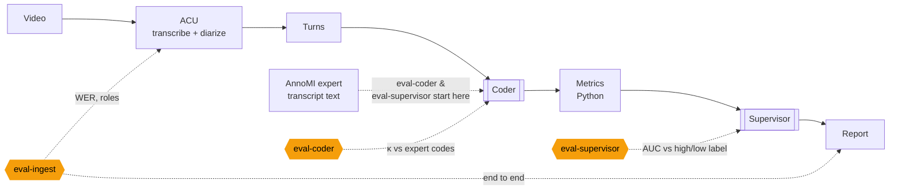
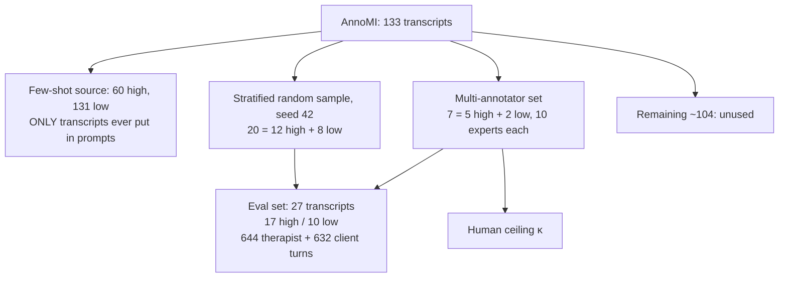
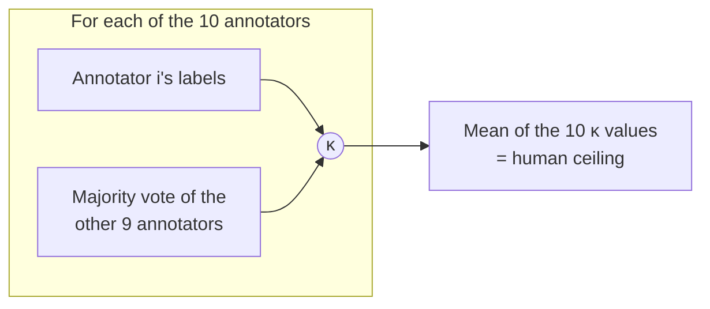
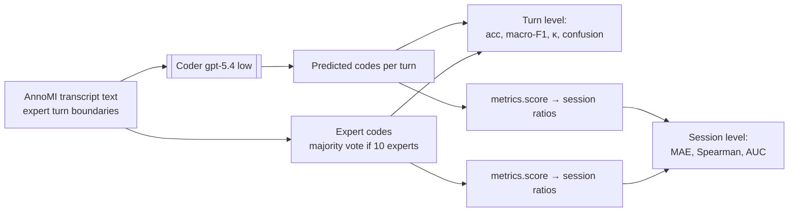
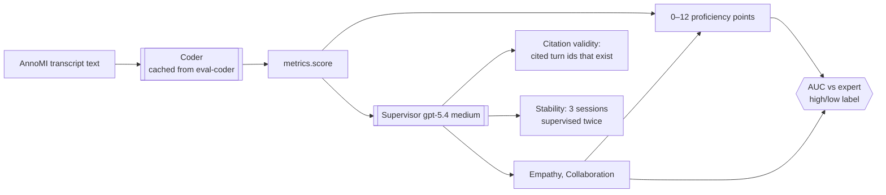
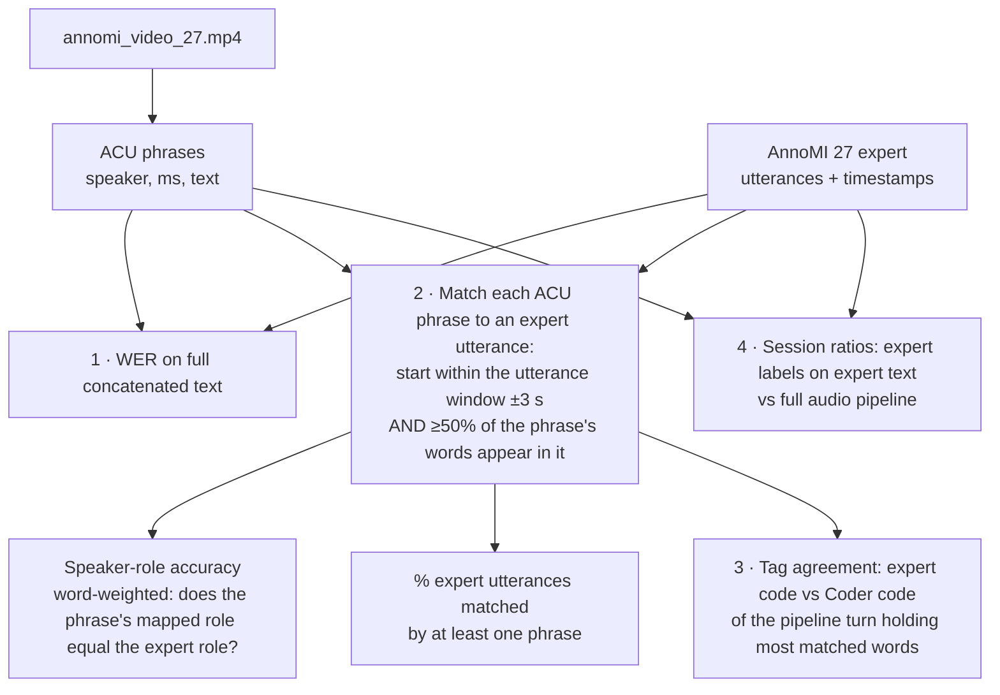

# How MI Review Coach is evaluated

An explanation of the three evaluations in `src/mi_review/evals/`: what each one measures, which part of the pipeline it tests, how every number is calculated (with real AnnoMI examples), and what to watch out for in the demo.

---

## 0. One-page summary

| Eval | Component tested | Input | Reference ("ground truth") | Metrics | Headline result |
|---|---|---|---|---|---|
| `eval-coder` | **Coder agent** only | Expert transcript **text** (no audio, no CU) | AnnoMI expert label for every turn | Accuracy, Macro-F1, **Cohen's κ**, confusion matrix, **human ceiling**; session-level MAE, Spearman, AUC | κ 0.85 main behaviour; on the 7 multi-annotator sessions 0.88 vs human ceiling 0.81 |
| `eval-supervisor` | **Supervisor agent** + rubric (Coder output feeds it) | Expert transcript text → Coder → metrics → Supervisor | AnnoMI **session quality label** (high / low) | **AUC**, mean score by quality, band counts, citation validity, stability | AUC 0.976 for the 0–12 score (164 of 170 pairs right) |
| `eval-ingest` | **ACU transcription + diarization** (and the full pipeline end to end) | The real **video** | AnnoMI expert transcript of the same video | **WER**, speaker-role accuracy, % utterances matched, tag agreement | WER 10%, roles 100% (video 27) |



**Why the evals are split this way:** `eval-coder` and `eval-supervisor` start from the expert's transcript text, so transcription errors cannot affect them. Each one isolates a single agent. `eval-ingest` is the only eval that touches audio. It runs on one video, because we have the video for only a few AnnoMI transcripts.

---

## 1. The data: AnnoMI and the held-out split

**AnnoMI:** 133 MI demonstration transcripts from YouTube, 110 rated *high* quality and 23 *low*. Each utterance has codes such as `main_therapist_behaviour`, `reflection_subtype`, `question_subtype` and `client_talk_type`.

- **126 transcripts** were coded by **one** expert (out of a pool of 10).
- **7 transcripts** (7, 27, 55, 56, 66, 109, 130) were coded by **all 10** experts. For these, the reference label is the **majority vote**, and the experts' agreement with one another gives the **human ceiling**.



| Fact | Value (verified) |
|---|---|
| Eval transcripts | 27 (17 high, 10 low) |
| Turns | 644 therapist + 632 client = **1,276** |
| Expert therapist codes in eval set | question 191, other 187, reflection 159, therapist_input 107 |
| Expert client codes in eval set | neutral 434 (69%), change 119, sustain 79 |
| Leakage | Few-shot (60, 131) ∩ eval set = ∅ (protected by a unit test). Video 27 is in the eval set but never a few-shot example. `benchmarks.json` is used only for display in the UI and never appears in a prompt. |

### Majority vote (how the 10-expert reference is formed)

Transcript 27, client utterance 1: *"Yeah, I definitely don't wanna come back here. But the doc said Oscar, my dog, is connected to my asthma…"*

| Annotator | 0 | 1 | 2 | 3 | 4 | 5 | 6 | 7 | 8 | 9 |
|---|---|---|---|---|---|---|---|---|---|---|
| Label | change | neutral | neutral | change | sustain | neutral | neutral | sustain | neutral | neutral |

6 neutral, 2 change, 2 sustain → reference = **neutral**. (Code: `annomi.gold_utterances()`.)

---

## 2. The metrics, with worked examples

### 2.1 Accuracy and Cohen's κ (kappa)

**Accuracy** is the share of turns where the model and the expert give the same label. Its weakness is that it rewards guessing the most common label.

**κ corrects for chance agreement:**

$$\kappa = \frac{p_o - p_e}{1 - p_e}$$

- $p_o$ = observed agreement (= accuracy)
- $p_e$ = the agreement two raters would reach by chance, given how often each one uses each label = $\sum_k \frac{\text{rowtotal}_k \cdot \text{coltotal}_k}{N^2}$

How to read κ: 0 = chance · 0.4–0.6 moderate · 0.6–0.8 substantial · > 0.8 almost perfect.

**Real example:** transcript 27, the 11 client utterances. Annotator 0 is compared with the majority vote of the other 9 annotators (this is exactly how the human ceiling works; see 2.3).

| Annotator 0 ↓ / Majority of others → | change | neutral | sustain | row total |
|---|---|---|---|---|
| change | 0 | 3 | 0 | 3 |
| neutral | 0 | **4** | 0 | 4 |
| sustain | 0 | 0 | **4** | 4 |
| col total | 0 | 7 | 4 | N = 11 |

- $p_o = (0+4+4)/11 = 0.727$, so accuracy is 73%
- $p_e = (3·0 + 4·7 + 4·4)/11^2 = 44/121 = 0.364$
- $\kappa = (0.727 - 0.364)/(1 - 0.364) =$ **0.571**: moderate agreement, although accuracy is 73%

**Why κ matters here:** a "lazy coder" that labels every client turn *neutral* gets **69% accuracy** on the eval set (434/632), and 64% across all of AnnoMI, but **κ = 0**. Its $p_e$ equals its $p_o$.

Code: `sklearn.metrics.cohen_kappa_score` in `eval_coder._agreement`.

### 2.2 Macro-F1

For each label, F1 = harmonic mean of precision and recall. **Macro** means a plain average across labels, so rare labels (sustain, advice) count as much as common ones.

For the lazy all-neutral coder:

- F1(neutral) = 2·0.69·1.0/(0.69+1.0) = 0.81
- F1(change) = 0 and F1(sustain) = 0
- **Macro-F1 = 0.27**, even though accuracy is 69%

### 2.3 Human ceiling (leave-one-out κ)

Human experts also disagree with each other. The ceiling tells you how much agreement is realistic.



- The ceiling uses only the 7 multi-annotator transcripts (428 utterances).
- Code: `eval_coder.human_ceiling`.
- Recomputed in this review; all values match the README.

| Code family | Human ceiling κ |
|---|---|
| main_behaviour (reflection / question / input / other) | 0.811 |
| reflection (none / simple / complex) | 0.569 |
| question (none / open / closed) | 0.803 |
| therapist_input (none / info / advice / negotiation / options) | 0.634 *(not shown in the README)* |
| client talk_type (change / neutral / sustain) | 0.578 |

**How to say it in the demo:** "If the Coder's κ is near the ceiling, it agrees with the expert consensus about as well as a single expert does."

### 2.4 Confusion matrix

Rows = expert label, columns = model label. Off-diagonal cells show *which* labels get confused (for example, simple vs complex reflection, or neutral vs change). Prompt tuning was driven by this matrix. For example, experts code bare "Yes." / "Okay." as *neutral*, and adding that rule raised client-talk κ from 0.47 to 0.61 (measured on gpt-5.4-mini).

### 2.5 Session-level: MAE and Spearman ρ

For each of the 27 transcripts, the rubric ratios (R:Q, %open questions, %complex reflections, change talk ratio) are computed twice:

- once from **expert** codes;
- once from **Coder** codes (same `metrics.score()` function).

They are compared with two statistics:

- **MAE**: mean |expert value − Coder value|. For example, if the expert R:Q is 1.20 and the Coder's is 1.00, the error is 0.20.
- **Spearman ρ**: correlation of the *rankings* (−1 to 1). It asks whether the Coder ranks sessions in the same order as the experts, even if the absolute values are slightly off. ρ = 0.89 for change talk ratio means the ranking is nearly identical.

### 2.6 AUC (high vs low quality)

$$\text{AUC} = P(\text{score of a random high session} > \text{score of a random low session})$$

A tie counts ½. Code: `annomi.auc`. 1.0 = perfect separation, 0.5 = coin flip, below 0.5 = inverted.

**Real example:** expert change talk ratio for 3 high and 2 low eval transcripts.

| | Low 17 (CTR 0.00) | Low 9 (CTR 1.00) |
|---|---|---|
| High 38 (0.46) | ✓ 1 | ✗ 0 |
| High 14 (0.83) | ✓ 1 | ✗ 0 |
| High 42 (1.00) | ✓ 1 | tie ½ |

AUC = (1+0+1+0+1+0.5)/6 = **0.58**

In the full eval there are 17 × 10 = **170 high/low pairs**. In the latest run, 164 pairs are correctly ordered, 4 are tied and 2 are reversed: AUC = (164 + 4 × ½)/170 = **0.976**.

### 2.7 WER (word error rate)

$$\text{WER} = \frac{S + D + I}{N_{\text{reference words}}}$$

where S, D and I are the substitutions, deletions and insertions needed to turn the expert text into the ACU text. Both texts are lower-cased and stripped of punctuation first (`eval_ingest._norm`).

Two real examples from video 27:

| Expert (reference) | ACU (hypothesis) | Errors | WER |
|---|---|---|---|
| "I have even read them. All I've been doing is taking the medicine…" (21 words) | "I **haven't** read them. All I've been doing…" | 1 sub (have→haven't), 1 del (even) | 2/21 = **9.5%** |
| "Mm-hmm. Yeah, I de-I definitely don't wanna come back here." (12 words) | "Yeah, I definitely don't want to come back here." | 1 sub, 4 del, 1 ins | 6/12 = **50%** |

The second row shows that many "errors" are **disfluencies and filler** ("Mm-hmm", "de-I", "wanna") that the human transcriber kept and ACU cleaned up, so WER **overstates** meaningful errors. In the first row ACU's "haven't" may even be what was actually said.

---

## 3. `eval-coder`: are the turn codes right?



- **What it isolates:** only the Coder's labelling. Turn boundaries and speaker roles come from the expert transcript, so ACU errors play no part.
- **Five code families are scored:**
  - main_behaviour, reflection, question and therapist_input (therapist turns);
  - talk_type (client turns).
- **Reported twice:**
  - over **all 27** transcripts (1,276 turns);
  - over the **7 multi-annotator** transcripts only. This is the like-for-like comparison with the human ceiling (see Issue 1).
- **Caching:** predictions are stored under `data/output/eval/coder/<model>_<effort>_<prompthash>/`. Editing the prompt changes the hash, which forces a fresh run.

**Results (re-run 2026-11-12, prompt `36aca3fa`, cached in `data/output/eval/coder/gpt-5.4_low_36aca3fa/`):**

| Code family | gpt-5.4 acc / macro-F1 (all 27) | gpt-5.4 κ (all 27) | gpt-5.4 κ (7 multi) | Human ceiling κ (same 7) | gpt-5.4-mini κ (all 27) |
|---|---|---|---|---|---|
| Main behaviour | 0.89 / 0.88 | **0.85** | 0.88 | 0.81 | 0.78 |
| Reflection none/simple/complex | 0.86 / 0.74 | **0.70** | 0.76 | 0.57 | 0.57 |
| Question none/open/closed | 0.89 / 0.83 | **0.78** | 0.87 | 0.80 | 0.78 |
| Therapist input type | 0.85 / 0.49 | **0.57** | 0.69 | 0.63 | 0.54 |
| Client change/neutral/sustain | 0.81 / 0.77 | **0.64** | 0.72 | 0.58 | 0.55 |

**Like-for-like (same 7 sessions), the Coder beats the human ceiling on all five families.** Time per session: 38 s (gpt-5.4) vs 9 s (mini).

#### Two ways to compare with the 10 experts (7 multi-annotator sessions)

| Method | Model side | Human side |
|---|---|---|
| **A. vs consensus** (the eval's default) | LLM vs the majority vote of all 10 | Each expert vs the majority of the other 9 (= "human ceiling"), averaged |
| **B. Pairwise** (computed offline from the cached predictions) | LLM vs **each** expert separately → 10 κ values, averaged | Expert vs expert for **all 45 pairs**, averaged |

| Code family | A: LLM vs majority | A: Human ceiling | **B: LLM vs each expert, mean (min–max)** | **B: Expert vs expert, mean (min–max)** | LLM rank among 11 coders* | B: mini vs each expert |
|---|---|---|---|---|---|---|
| Main behaviour | 0.88 | 0.81 | **0.80** (0.67–0.84) | 0.74 (0.58–0.83) | **1st** | 0.73 |
| Reflection none/simple/complex | 0.76 | 0.57 | **0.61** (0.46–0.70) | 0.50 (0.30–0.65) | **1st** | 0.53 |
| Question none/open/closed | 0.87 | 0.80 | **0.78** (0.58–0.88) | 0.74 (0.56–0.90) | 2nd | 0.79 |
| Therapist input type | 0.69 | 0.63 | **0.57** (0.49–0.65) | 0.51 (0.32–0.68) | 3rd | 0.51 |
| Client change/neutral/sustain | 0.72 | 0.58 | **0.56** (0.39–0.72) | 0.47 (0.24–0.65) | **1st** | 0.54 |

\* Treat the LLM as an 11th coder. Each coder's score is its average pairwise κ with the 10 humans (a human is compared with the other 9). Rank 1st means the LLM agrees with the experts more than any single expert agrees with the others.

**How to read it:**
- Method B numbers are lower than method A for *both* the model and the humans. A single expert is noisier than a 10-way majority, so compare within one method, never across.
- Under both methods gpt-5.4 is above the human level on all five families. Method B is the stricter test, because the model gets no help from a cleaned-up consensus.
- Demo line: *"Treated as an 11th coder, MIRA ranks first of 11 on behaviour type, reflections and client talk."*

Script (not yet part of the repo): `C:\Users\RAHUL~1.NAK\AppData\Local\Temp\claude\de9a06d6fbfec031\e3810fc4-d32d-4512-9ac8-159dce4e3bf1\scratchpad\pairwise.py`. Results are saved to `data/output/eval/coder/pairwise_kappa.json`, including each expert's individual κ.

**Confusion matrices (rows = expert, columns = Coder), all 27 transcripts:**

| Main behaviour | → reflection | question | input | other |
|---|---|---|---|---|
| reflection (159) | **141** | 6 | 8 | 4 |
| question (191) | 8 | **173** | 10 | 0 |
| therapist_input (107) | 4 | 9 | **88** | 6 |
| other (187) | 3 | 6 | 8 | **170** |

| Client talk | → change | neutral | sustain |
|---|---|---|---|
| change (119) | **94** | 19 | 6 |
| neutral (434) | 51 | **349** | 34 |
| sustain (79) | 1 | 8 | **70** |

| Reflection | → complex | none | simple |
|---|---|---|---|
| complex (110) | **66** | 8 | 36 |
| none (460) | 6 | **441** | 13 |
| simple (74) | 12 | 13 | **49** |

Reading them:
- The Coder rarely confuses *behaviour type*.
- Its main client-talk error is calling expert-*neutral* turns *change* (51 times). It is generous with change talk.
- On reflection depth, 36 of the 110 expert-complex reflections were coded *simple*.

**Session level:**

| Ratio | MAE | Spearman ρ | AUC (Coder codes) | AUC (expert codes) |
|---|---|---|---|---|
| Reflection : question | 0.37 | 0.85 | 0.89 | 0.76 |
| % open questions | 0.20 | 0.61 | 0.62 | 0.51 |
| % complex reflections | 0.26 | **0.33** | 0.82 | 0.69 |
| Change talk ratio | 0.10 | **0.94** | 0.83 | 0.87 |

%complex reflections ranks sessions poorly against the expert figure (ρ 0.33). This follows directly from the simple vs complex difficulty.

An earlier run (before this review) gave 0.86 / 0.68 / 0.77 / 0.58 / 0.66 for the all-27 κ, so run-to-run variation is about ±0.02.

---

## 4. `eval-supervisor`: do the scores separate good from poor MI?

AnnoMI has **no expert Empathy or Collaboration scores**, only one high/low label per session. The Supervisor therefore can't be compared number for number. Instead, the eval asks: **do its outputs rank high-quality sessions above low-quality ones?**



| Output | How it's computed |
|---|---|
| `auc_high_vs_low` | AUC (§2.6) for proficiency points, Empathy, Collaboration, and their mean ("relational") |
| `mean_by_quality` | Mean of each score for high and for low sessions |
| `bands_by_quality` | How many high/low sessions land in Developing / Basic / Advanced |
| `citation_validity` | valid cited turn ids ÷ all cited ids (invalid ones are dropped by `supervisor._check`) |
| `stability` | Transcripts 3 and 14 (high) and 9 (low) are supervised a second time; reports \|Δ Empathy\|, \|Δ Collaboration\| and \|Δ points\| |

**Results (re-run 2026-11-12, cached in `data/output/eval/supervisor/gpt-5.4_medium_1d9518c3/`):**

| Check | Result |
|---|---|
| AUC: points / Empathy / Collaboration / mean of both | **0.976** / 0.988 / 0.994 / **1.00** |
| 170 high-vs-low pairs | 164 correct, 4 tied, 2 reversed. High 3 and 18 scored 2 points; low 102 scored 3 and lows 27 and 123 scored 2. |
| Mean points high / low | 6.8 / 1.1 |
| Mean Empathy high / low | 3.74 / 1.70 |
| Mean Collaboration high / low | 3.50 / 1.60 |
| Bands, high sessions (n = 17) | 2 Advanced, 7 Basic, **8 Developing** |
| Bands, low sessions (n = 10) | 10 Developing |
| Citation validity | 479 / 479 (100%), 0 items dropped |
| Supervisor re-run (3, 14, 9) | Points identical; transcript 9 Collaboration 2.5 → 1.5 |
| Traps most often found in high sessions | missed reflection (15), missed change talk (14) |
| Traps most often found in low sessions | confrontation–denial (8), persuasion without permission (7) |

The trap mix is a nice demo point: in good sessions the Supervisor flags *missed opportunities*, while in poor ones it flags *active MI violations*.

An earlier run gave AUC 0.994 / 0.98 / 1.00.

#### How the four AUCs are calculated (latest run, real numbers)

Every AUC uses **one number per session** and asks one question: *in a high-vs-low pair, does the high session get the bigger number?*

- 17 high × 10 low = **170 pairs**.
- Each pair scores **1** if high > low, **½** if they tie, and **0** if high < low.
- **AUC = total ÷ 170.**

Shortcut: line up the 10 low sessions once, then for each high session count how many lows it beats.

**The 10 low sessions:**

| Low session | 9 | 17 | 130 | 15 | 59 | 92 | 10 | 123 | 27 | 102 |
|---|---|---|---|---|---|---|---|---|---|---|
| Points (0–12) | 0 | 0 | 0 | 1 | 1 | 1 | 1 | 2 | 2 | **3** |
| Empathy | 1.5 | **2.5** | 1.5 | 1.5 | 1.5 | 1.5 | 1.5 | 1.5 | **2.5** | 1.5 |
| Collaboration | **2.5** | 1.5 | 1.5 | 1.5 | 1.5 | 1.5 | 1.5 | 1.5 | 1.5 | 1.5 |
| Mean of E & C | 2.0 | 2.0 | 1.5 | 1.5 | 1.5 | 1.5 | 1.5 | 1.5 | 2.0 | 1.5 |

**The 17 high sessions:** only two are hard to separate, transcripts **3** and **18** (2 points, Empathy 2.5, Collaboration 2.5, mean 2.5). The other 15 all have ≥ 4 points, Empathy ≥ 3.5, Collaboration ≥ 3.5 and mean ≥ 3.5, so each of them beats all 10 lows on every measure (15 × 10 = 150 wins).

| Measure | Credit for each of high 3 and 18 against the 10 lows | Credit, other 15 highs | Total | AUC |
|---|---|---|---|---|
| **Points** | beats 7 (0,0,0,1,1,1,1) + ties 2 (two 2s) × ½ + loses 1 (the 3) = **8** | 150 | 2×8 + 150 = 166 | 166/170 = **0.976** |
| **Empathy** | beats 8 (the 1.5s) + ties 2 (the 2.5s) × ½ = **9** | 150 | 2×9 + 150 = 168 | 168/170 = **0.988** |
| **Collaboration** | beats 9 + ties 1 × ½ = **9.5** | 150 | 2×9.5 + 150 = 169 | 169/170 = **0.994** |
| **Mean of E & C** | 2.5 beats every low (max 2.0) = **10** | 150 | 170 | 170/170 = **1.00** |

Why the mean is perfect: the low sessions that got 2.5 on one rating got 1.5 on the other, so their mean is only 2.0. The weakest high sessions get 2.5 on both. Averaging removes the ties.

> **Points** = sum of the six rubric metrics: four from the Coder's codes (R:Q, %open, %complex, %adherent) and two from the Supervisor (Empathy, Collaboration). See README §1. It mixes the work of both agents, which is why its AUC is a little lower than the Supervisor's ratings alone.

**Useful context (computed here):** if you score the 27 sessions with **expert codes only**, the four count metrics give an AUC of only **0.72** (mean 3.5 vs 1.9 points). The behaviour-count ratios alone separate good and poor MI only moderately, and the Supervisor's Empathy and Collaboration ratings provide most of the separation.

> Example: low-quality transcript 27, scored from **expert** codes, gets **4 points**. There are 2 reflections and 1 question, so R:Q = 2.0 (Advanced), and both reflections are complex, so %CR = 100% (Advanced). With so few events, ratios jump around. This is why the relational ratings matter.

---

## 5. `eval-ingest`: does the audio front end work?

Runs the full pipeline on a real video and compares the result with the expert transcript of **the same** video.



**Re-run in this review (offline, from cached ACU output and the cached report): video 27, low quality, asthma**

| Check | Result | Notes |
|---|---|---|
| WER | **10.2%** | Partly fillers and disfluencies (§2.7) |
| Speaker-role accuracy | **100%** | ACU's `ClinicianSpeaker` was correct |
| Expert utterances matched | **69.6%** (16/23) | The 7 unmatched ones are mostly "Mm-hmm" / "Yeah" interjections that ACU merged or dropped. 23 expert utterances became 13 pipeline turns. |
| Tag agreement: main behaviour | 75% (n = 8), κ 0.39 | n is tiny |
| Tag agreement: client talk | 75% (n = 8), κ 0.50 | n is tiny |
| R:Q expert vs pipeline | 2.00 vs 0.67 | Expert: 2 reflections / 1 question. Pipeline: 2 / 3. |
| %Complex reflection | 100% vs 0% | Expert called both reflections complex; Coder called both simple |
| Change talk ratio | 0% vs 0% | Agrees |
| Final score | 0/12, Developing | Correct direction for a low-quality session |

**Real side-by-side** (therapist turn at 0:32):

> *"Well, you sound a bit surprised by that. But I'm sure that you've seen some of the material that the clinic gave you…"*
>
> **Expert:** main = therapist_input, reflection = **complex** · **Coder (audio):** main = therapist_input, reflection = **simple**

The behaviour is the same; the two disagree only on the reflection depth. This is the simple-vs-complex wobble listed in Known limitations.

There is also a second saved ingest run, for AnnoMI 23 (high quality): WER 10.8%, roles 99.7%, 87% matched, main-behaviour κ 0.73. Its talk-type κ of **0.0 should not be quoted** (see Issue 4).

---

## 6. Verification status and issues found

### What I verified (no Azure cost)

| Claim | Status |
|---|---|
| 27 eval transcripts, 644 + 632 turns, 17 high / 10 low | ✅ Recomputed |
| Human ceiling 0.81 / 0.57 / 0.80 / 0.58 | ✅ Recomputed exactly |
| Ingest on video 27: WER 10%, roles 100%, 70% matched | ✅ Re-ran `eval-ingest` from cache (wrote `data/output/eval/ingest/annomi-27.json`) |
| No few-shot leakage; benchmarks only used in the UI | ✅ Code checked |
| "1 pair out of 170" for AUC 0.994 | ✅ Was consistent with the earlier run's chart data. The re-run gives 0.976 (2 reversed, 4 tied); deck updated. |
| Coder κ (gpt-5.4 and mini) and Supervisor AUC / means | ✅ **Re-run (paid) on 2026-11-12.** Numbers changed slightly; README and deck updated to the new run. |

### Issues and caveats

| # | Issue | Where | Severity | What to do / say |
|---|---|---|---|---|
| 1 | **Model κ and human ceiling were measured on different sets.** All 27 transcripts vs only the 7 multi-annotator ones. | README §10, slide S16 | ✅ Fixed | Like-for-like κ now reported; it beats the ceiling on all 5 families. The S16 chart now shows the 7-session values. |
| 2 | ✅ Fixed. **"Stability: identical scores" is Supervisor-only.** In `eval_supervisor._supervised` the Coder output is read from the cache, so the re-run reuses the same codes. It does not measure the Coder variance that moves the demo video between 6 and 8 points (README §15). Only 3 sessions were re-run. | README §10, slide S17 | Medium | Say "Supervisor ratings were stable on re-runs". Don't say "scores are identical on re-runs", which contradicts the honest-gaps slide. |
| 3 | ✅ Fixed. **"Labelled by 10 experts."** Only 7 of the 133 transcripts were labelled by 10 experts; the other 126 were labelled by one expert each, drawn from a pool of 10. | Speaker notes S-AnnoMI (line 56) | Low–Medium | "133 expert-annotated sessions; 7 of them independently coded by 10 experts." |
| 4 | **AnnoMI 23's talk-type κ = 0.0 is a degenerate result.** The single annotator labelled all 39 client utterances *neutral*, so the expert data has only one class and κ is 0 by definition, whatever the model does. The expert change talk ratio is also undefined. | `eval/ingest/annomi-23.json` | Low | Don't quote it. If asked, explain that the expert labels have no variation. |
| 5 | ✅ Fixed in README. **The "lazy coder" accuracy number differs between sources.** README says 60%; the speaker notes say 64% (all of AnnoMI). On the eval set it is **69%**. | README §9.2 | Low | Use "about 65–70%". Any of these is fine as an illustration, but be consistent. |
| 6 | **Reflection κ mixes two judgements.** κ 0.68 is over none/simple/complex for every therapist turn, so it includes the easy "is there a reflection?" decision. Measured: on simple vs complex alone the Coder gets κ **0.42**, while experts reach only **0.22** with each other. | README §10 | Low | When describing the 0.68, call it "reflection coding", not "simple vs complex". |
| 7 | **AUC measures ranking, not calibration.** Expert-rated *high* sessions average 6.7 points, which falls in the **Developing** band (< 7). The score orders sessions well but sits low on the absolute scale. | README §10 | Info | Already covered by "our bands are strict" (S18); keep that line. |
| 8 | **Ingest is validated on one or two short videos.** Tag-agreement n = 8, and 23 utterances in total. | README §10 | Info | Present it as a sanity check, not a benchmark. |
| 10 | **Numbers from the re-run that differed from the deck:** AUC 0.994 → 0.976; Empathy/Collab AUC 0.98/1.00 → 0.99/0.99; means 6.65/1.0 → 6.8/1.1; "7 of 17 Developing" → 8; "40 of 110 complex → simple" → 36; citations 483 → 479; mini κ 0.76 → 0.78; "mini 2× faster" → about 4×; "one mis-ordered pair" → 2 reversed + 4 tied. | Deck, notes, README | ✅ Fixed | — |
| 11 | **"0.47 → 0.61" client-talk κ with the neutral rule** cannot be re-verified: it needs the old prompt, and current mini gets 0.55 on client talk. | Slide S16, README | Low | Now phrased as "+0.14 on gpt-5.4-mini when the rule was introduced". |
| 9 | Minor: majority-vote ties (e.g. 5–5) are broken by pandas `value_counts` order, which is effectively arbitrary. The model is compared with the majority of 10 annotators and each human with the majority of 9, which slightly favours the model. | `annomi.py`, `eval_coder.py` | Very low | No action needed. |

---

## 7. Demo cheat-sheet (safe phrasing)

- **Coder:** "On 1,276 held-out expert-coded turns, the Coder reaches κ 0.85 on behaviour type."
- **Human ceiling:** "On the 7 sessions that 10 experts coded independently, the Coder agrees with the expert consensus better than a typical expert does, on all five code families."
- **Supervisor:** "Without seeing the quality label, MIRA scores the good session higher in 164 of 170 good-vs-poor pairs (AUC 0.98). Empathy and Collaboration together separate every pair."
- **Grounding:** "100% of the cited turns exist, because the LLM cites ids and Python inserts the quote and timestamp."
- **Audio:** "On a held-out real video, transcription WER is about 10%, much of it filler words, and the speaker roles were 100% right."
- **Honest gap:** "Simple vs complex reflection is the hardest call. On that call alone experts agree only κ 0.22 with each other (we get 0.42), and our fix is a 3-run majority vote."

---

## 8. Reproduce

```powershell
uv run mi-review eval-coder        # costs tokens; cached per prompt hash
uv run mi-review eval-supervisor   # reuses Coder cache; costs Supervisor tokens
uv run mi-review eval-ingest       # free if the CU cache and report for video 27 exist
```

Outputs are written to `mi_project/data/output/eval/{coder,supervisor,ingest}/`. Open `summary.json` in each folder, including `agreement.multi_annotator` for Issue 1.
