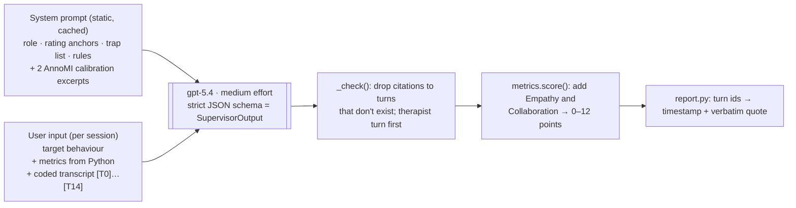

# Supervisor walkthrough: one real session

This is one real Supervisor call from the 2026-11-12 eval run: **AnnoMI transcript 42**, rated high quality by experts, topic *weight loss*, 15 turns. Every value below is copied from the cached run in `data/output/eval/supervisor/gpt-5.4_medium_1d9518c3/42.run1.json`.



---

## 1. System prompt (same for every session, about 8k characters, mostly cache hits)

File: `src/mi_review/prompts/supervisor_system.md`

| Section | What it tells the model |
|---|---|
| Role | "Expert MI clinical supervisor and MITI 4.2.1 rater." |
| What you receive | The metrics are **facts; do not recompute or contradict them**. The codes come from an automatic coder and can be wrong, so judge by the words. |
| Task 1: global ratings | MITI anchors 1–5 for **Empathy** and **Collaboration**, half-points allowed. Write the justification first, then the score, and cite 1–3 turn ids. Advice-heavy or lecturing sessions can't score above 2 on Collaboration. |
| Task 2: what went well | 1–3 items, each with a skill (complex reflection, open question, affirmation, …) and turn ids: the therapist turn first, then the client turn that shows the impact. |
| Task 3: what to improve | 1–3 items, each naming a trap from a fixed list (expert, question–answer, confrontation–denial, premature focus, labeling, blaming, persuasion without permission, missed change talk, missed reflection) and giving a **better_response** in the clinician's voice. |
| Task 4 | `overall_summary` (3–4 sentences on MI spirit) and 2–3 `coaching_tips`. |
| Rules | Cite only turn ids that exist. **Never write quotes or timestamps** (the application inserts them). Address the clinician as "you". Stay consistent with the metrics. |
| Calibration | Two 12-turn excerpts with expert codes: transcript 60 (HIGH, "typically 4–5") and 131 (LOW, "typically 1.5–2.5"). |

## 2. User input (built by `supervisor.render_input`, sent verbatim)

The Coder's labels appear in `<…>`. The metrics come from `metrics.py`, not from an LLM.

```text
TARGET BEHAVIOUR: weight loss

SESSION METRICS:
- Therapist turns 7, client turns 8; therapist share of words 32%
- Questions 2 (open 1, closed 1); reflections 4 (simple 2, complex 2); turns with therapist input 0
- MI-adherent turns 5, MI-non-adherent turns 0
- Client talk: change 4, sustain 0, neutral 4; change talk ratio 100%
- Reflection-to-Question Ratio: 2.00 (advanced; basic >= 1.0, advanced >= 2.0)
- % Open Questions: 50% (basic; basic > 0.4, advanced > 0.5)
- % Complex Reflections: 50% (basic; basic > 0.4, advanced > 0.5)
- % MI Adherent: 100% (advanced; basic >= 0.9, advanced >= 1.0)

CODED TRANSCRIPT:
[T0 00:00] CLIENT <change>: I don't know, I'm just having a lot of hard trouble trying to lose the rest of the weight. Um, right now, it's like no matter how much I try to exercise, run, or whatever, it doesn't matter like nothing else is coming off.
[T1 00:14] THERAPIST <reflection; R=simple; Q=none; input=none; MITI=none; adherent>: Right, so you've hit a plateau in your weight and despite all the things that you're trying to do to increase your activity, it doesn't seem to be working on the scale?
[T2 00:22] CLIENT <change>: No, and I don't know what I'm doing wrong because I keep trying the exercise but nothing's happening.
[T3 00:30] THERAPIST <reflection; R=complex; ...; adherent>: Right. So you feel like you're spinning your wheels, you're doing more exercising and it's not showing results on the scale?
[T4 00:36] CLIENT <neutral>: Yes.
[T5 00:36] THERAPIST <reflection; R=simple; ...; adherent>: And you're not feeling so good about that?
[T6 00:38] CLIENT <neutral>: No, and even when I'm coming home, like, I'll go to the gym ... I try to talk to my mama about it or even my father, and no one even cares about it. Like no one wants to support in it anyway.
[T7 00:55] THERAPIST <reflection; R=complex; ...; adherent>: Uh, so you feel like you're doing this all alone?
[T8 00:57] CLIENT <neutral>: Yes.
[T9 00:58] THERAPIST <question; R=none; Q=closed; ...; neutral>: At home or you think that they'll be supportive but they're not giving- they're not giving you what you need?
[T10 01:04] CLIENT <change>: No, and specifically my father, he just-- Not only does he not want to support me with it but at the same time, he feels like I need to be gaining my weight back.
[T11 01:16] THERAPIST <other; ...; neutral>: Oh, okay.
[T12 01:17] CLIENT <neutral>: So I—
[T13 01:19] THERAPIST <question; Q=open; ...; adherent>: Tell me about that.
[T14 01:20] CLIENT <change>: It's as though by me losing weight, it's like I'm somehow disconnecting from my family ... I just want to be healthy, I just want to have a good body and he doesn't think of it that way.
```

(`...` shortens repeated code fields and long sentences here only; the model receives the full text.)

## 3. Model output (strict JSON, abbreviated)

**Global ratings**

| | Score | Evidence turns | Justification (shortened) |
|---|---|---|---|
| Empathy | **4.5** | T1, T3, T7 | Consistent effort to understand the frustration, e.g. "spinning your wheels". "Doing this all alone" captured an emotional layer the client affirmed. |
| Collaboration | **4.5** | T7, T9, T13 | Followed the client's concerns, no advice. "Tell me about that" let the client steer; the closed, leading question at T9 briefly narrowed it. |

**What went well**

| Title | Skill | Turns |
|---|---|---|
| Captured the stuck feeling beneath the plateau | complex_reflection | T3 → T4 |
| Named the loneliness in the struggle | complex_reflection | T7 → T8 |
| Opened space for the family meaning of weight loss | open_question | T13 → T14 |

**What to improve**

| Title | Trap | Turns | better_response |
|---|---|---|---|
| Reflect the hurt before clarifying support details | missed_reflection | T9, T10 | "It sounds really painful that when you're working this hard, the people you most want support from aren't showing up for you in the way you need." |
| Strengthen change talk instead of moving past it | missed_change_talk | T11, T13 | "So on one hand you're trying to get healthier, and on the other hand your father is pulling you back toward something you don't want for yourself." |

**Summary and tips (shortened):** "A strong MI-consistent segment… the client's talk evolved from frustration about a plateau into a values-based statement about wanting health… Growth edge: trust reflections at emotional moments rather than clarifying too quickly." The 3 tips include *"When the client expresses pain, try a reflection before any follow-up question."*

## 4. What Python does after the call

| Step | Result for transcript 42 |
|---|---|
| Citation check (`_check`) | 16 turn ids cited, 16 valid, 0 items dropped |
| Final rubric (`metrics.score` with E and C added) | Empathy 4.5 → Advanced **2** · Collaboration 4.5 → Advanced **2** · R:Q 2.00 → Advanced **2** · %Open 50% → Basic **1** (needs > 50% for Advanced) · %Complex 50% → Basic **1** · %Adherent 100% → Advanced **2** |
| Proficiency | **10 / 12, Advanced proficiency** (expert label: high ✔) |
| Report (`report.py`) | Each cited id becomes a timestamp and verbatim quote, e.g. T3 → `[00:30] "Right. So you feel like you're spinning your wheels…"`. The UI's ▶ button seeks the video to that time. |
| Cost | 3,338 input tokens (2,304 cached), 1,837 output tokens (1,034 of them reasoning), 25.6 s |

**Key point for the demo:** the LLM decides *judgements* (two ratings and which moments matter, with its reasons). Python decides the *numbers* (ratios, thresholds, points) and the *evidence* (quotes and timestamps). Because of that split, the feedback can't misquote the session or invent a timestamp.
