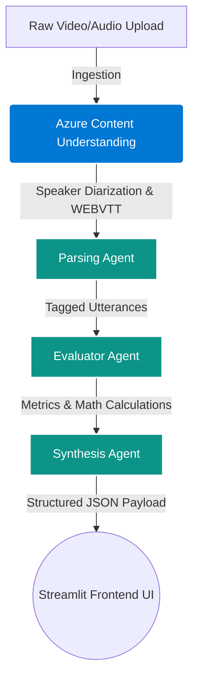
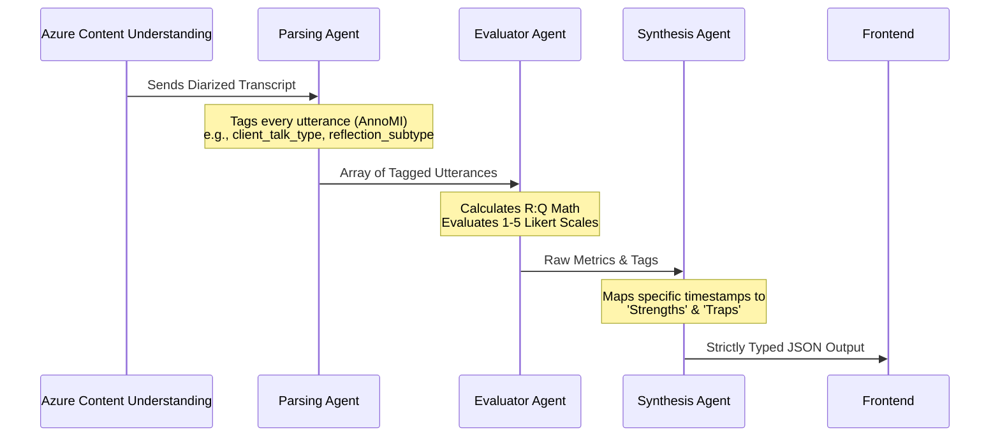

# Solution Approach: MIFlow - Motivational Interviewing AI Review App
 
## 1. The Motivational Interviewing (MI) Domain & Ecosystem
 
**Motivational Interviewing (MI)** is an evidence-based, collaborative conversational style designed to strengthen a person’s own motivation and commitment to change.
 
*   **The Ecosystem:** The interaction primarily involves a **Clinician** (acting as a collaborative guide rather than an authoritarian expert) and a **Client** (who is often experiencing ambivalence about a behavioral change, such as diet, substance use, or medication adherence).
*   **Real-World Example:**
    *   *Traditional/Expert Approach (The Trap):* "You must stop eating sugar immediately because your lab results are dangerously high." (Elicits defensiveness/sustain talk).
    *   *MI Approach (The Spirit):* "What are your thoughts on how your current diet might be affecting your energy levels throughout the day?" (Elicits autonomy and client-driven change talk).
 
## 2. Key Decisions: Rubrics & Evaluation Framework
 
To provide objective, clinically valid feedback, this application utilizes an **8-Metric Evaluation Framework** grounded in established clinical thresholds.
 
### The 6 Core Therapist Metrics
These metrics measure the clinician's specific behaviors and conversational style. They are evaluated against exact benchmarks to determine basic or advanced competency.
 
| Metric | Description | Basic Threshold | Advanced Threshold |
| :--- | :--- | :--- | :--- |
| **Empathy (1-5)** | Measures active interest in the client's perspective. *Low (1):* Indifference or dismissal of client's feelings. *High (5):* Deep understanding and active interest. | 3.5 | 4.0 |
| **Collaboration (1-5)** | Fostering power-sharing. *Low (1):* Counselor assumes expert/authoritarian role. *High (5):* Cooperative partnership driving the session. | 3.5 | 4.0 |
| **Reflection-to-Question Ratio** | Number of reflections divided by number of questions. | 1.0 (1:1) | 2.0 (2:1) |
| **% Open Questions** | Percentage of open-ended questions vs. closed-ended questions. | > 40% | > 50% |
| **% Complex Reflection** | Percentage of complex reflections (adding deep meaning/hypothesis) vs. simple reflections (parroting). | > 40% | > 50% |
| **% MI Adherent** | Percentage of all behaviors consistent with MI (excluding non-adherent traps like unsolicited advice or confrontation). | > 90% | 100% |
 
### Global MI Proficiency Score
The above 6 metrics culminate in a unified **MI Proficiency Score (Range 1-12)**. Achieving the "Basic" threshold on a metric grants 1 point; "Advanced" grants 2 points. A total score of 7-9 indicates basic clinical proficiency, while 10-12 indicates advanced proficiency.
 
### The Client Impact Metric
To measure whether the clinician's techniques are actually working, we track the client's language using the following ratio:
 
$$ \text{Change Talk Ratio} = \frac{\text{Change Talk}}{\text{Change Talk} + \text{Sustain Talk}} \times 100 $$
 
*Note: Neutral and other utterances are intentionally excluded from the denominator.*
 
**Example:**
> **Client:** "I know I need to start exercising because of my heart **[Change Talk = 1]**, but I am just so exhausted after working a 10-hour shift **[Sustain Talk = 1]**."
> *Ratio Calculation:* 1 / (1 + 1) = **50%**
 
## 3. End Goal & Positive Impact
 
Currently, evaluating MI sessions requires manual review by highly trained human fidelity coders, making it expensive, slow, and unscalable.
 
**The MIFlow Impact:**
*   **Scalability:** Automates transcription and fidelity coding instantly.
*   **Objectivity:** Strict adherence to universal MITI (Motivational Interviewing Treatment Integrity) standards. By anchoring the LLM prompts to official guidelines from [motivationalinterviewing.org](https://motivationalinterviewing.org/) and established clinical research (e.g., Barnett et al. MI proficiency frameworks), the app evaluates based on validated industry standards, not arbitrary or self-invented rules.
*   **Training Acceleration:** Provides practitioners with immediate, timestamp-grounded coaching (identifying specific conversational "traps" and "strengths"), drastically reducing the feedback loop for behavioral health professionals.
 
## 4. Data Lifecycle & System Architecture
 

 
*   **Input Data:** Video/Audio files (synthetic or role-played hackathon data).
*   **Extracted Data:** WEBVTT transcripts with exact millisecond timestamps and strict speaker separation (Clinician vs. Client) via ACU.
*   **Generated Output:** A strictly typed JSON object processed sequentially through the agent pipeline.
*   **Frontend Display:** A Streamlit web dashboard displaying calculated metric visualizations, categorized feedback, and a transcript linking directly to video timestamps.
 
## 5. End-to-End Multi-Agent Pipeline
 
To manage the complex cognitive load of clinical evaluation, the backend uses a sequential, multi-agent LLM pipeline.
 

 
### Simple Execution Example
 
**The Transcript:**
> *Clinician (00:10):* "Are you taking your pills?"
> *Client (00:15):* "I skip them when I have to drive early."
> *Clinician (00:22):* "You feel frustrated because the side effects interfere with your daily routine."
 
**Pipeline Processing:**
1.  **Parsing Agent:**
    *   Turn 1 (00:10): `main_therapist_behaviour`: "question", `question_subtype`: "closed".
    *   Turn 2 (00:15): `client_talk_type`: "sustain".
    *   Turn 3 (00:22): `main_therapist_behaviour`: "reflection", `reflection_subtype`: "complex", `mi_adherance`: "adherent".
2.  **Evaluator Agent:**
    *   Calculates **R:Q Ratio**: 1 Reflection / 1 Question = 1.0 (Basic Competency met).
    *   Calculates **Complex Reflection %**: 100% (Advanced Competency met).
3.  **Synthesis Agent:**
    *   Flags `00:10` as a "Closed Question Trap" and `00:22` as a "Strength: Complex Reflection", formatting everything into a final JSON schema for the frontend.
 
## 6. Tech Stack
*   **Azure Content Understanding (ACU):** Utilized for video/audio downsampling, WEBVTT alignment, and high-fidelity speaker diarization.
*   **Azure AI Foundry:** Hosts the Multi-Agent LLM pipeline utilizing OpenAI models, heavily relying on the `response_format: { type: "json_schema" }` feature to guarantee robust, application-ready data flow between agents.
*   **Frontend UI - Streamlit (Python):** Chosen for rapid AI prototyping. Streamlit allows for seamless integration with Azure Python SDKs, offering built-in data visualization (charts, metrics) and media playback capabilities out-of-the-box without requiring complex web-development frameworks.
Welcome to the Motivational Interviewing Website! | Motivational Interviewing Network of Trainers (MINT)
 