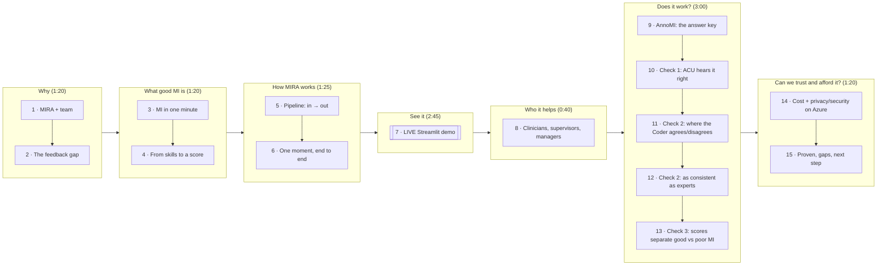

# MIRA: hackathon screening presentation plan (v2)

**Status:** built in this folder (`index.html`, see `README.md`).
**Format:** 15 slides (8:40 of slides) + Streamlit walkthrough of the saved report (2:45) ≈ **11:25**, leaving ~30 s of buffer under 12 min.
**Audience:** judges who don't know MI. **Order:** follows the five points in the screening email (team/problem → idea/approach → features → healthcare → compliance/impact), with the evaluation after the demo.
**Rule for every number:** it has to come from code or from cached outputs under `mi_project/data/output/`. Where the existing deck disagrees with the code or the eval docs, the code and docs win.

## 1. Narrative arc (one line)

> Clinicians improve at MI through feedback, but expert review is too slow and scarce to provide it. **MIRA** turns a recorded session into evidence-linked coaching in about 1–2 minutes. Tested against AnnoMI's expert labels, it agrees with the experts about as well as they agree with each other, for roughly 9¢ per 3-minute review on Azure.

## 2. Slide-to-slide flow

## 3. Slide-by-slide plan

Running examples throughout:
- **"Mia"** (role-play, vaping, high quality): saved report `Motivational_Interviewing_in_Action__Rol-7e38dc72-39-223.json`, 8/12 Basic.
- **"Sal"** (AnnoMI 27, asthma/dog, low quality): saved report `annomi_video_27-d2518c2b-0-end.json`, 0/12 Developing.

| # | Title (working) | Purpose | Key visual | Spoken takeaway | Time | Evidence / source |
|---|---|---|---|---|---|---|
| 1 | **MIRA: AI review for Motivational Interviewing** | Name, team, promise | Logo/title, team names (PhoenixAI), one-line promise: "Upload a session → coaching in ~1–2 min" | "We're Team PhoenixAI. We built MIRA, which gives every recorded MI session expert-style feedback." | 0:15 | README §1. Team: PhoenixAI (Rahul Nakka, Deependra Shekhawat) |
| 2 | **Feedback builds MI skill, but expert review doesn't scale** | Problem: manual review burden, and the need for timely and consistent feedback | Loop diagram: *session → wait for trained coder → feedback late or never*. Side stat: **even experts disagree**: average expert-vs-expert κ on client talk is 0.47 (pairwise, 10 experts) | "Feedback means a trained coder going through a recording turn by turn. It's slow and scarce, so most sessions never get reviewed, and even two experts don't always agree." | 0:40 | `mi_approach_document.md` §3 and `gemini_report.md` intro (manual review is "resource-intensive"); κ 0.47 from `evaluation_explained.md` §3 table B / `pairwise_kappa.json`. Schwalbe 2014 dropped; "hours per session" kept as the team's own experience |
| 3 | **MI in one minute** | Just enough MI to follow the product | Top: **Sal vs Mia** split. Sal's clinician argues ("You've had two or three major asthma attacks… do you appreciate…") → client digs in: **0% change talk**. Mia's clinician asks ("Can we talk about the pros and cons… for you?") → "I felt out of breath… I just want to give it my best" → **67% change talk**. Bottom: a 4-step strip **Engaging → Focusing → Evoking → Planning**, each with one Mia line | "MI is a way of talking that helps people find their own reasons to change. Argue for change and the client argues back; ask and reflect, and the client talks themselves toward it." | 0:45 | Saved reports (turn texts, change talk ratio 0.0 vs 0.67); `gemini_report.md` (4 processes). ⚠ Mia's change talk was 83% in an earlier run; use the **saved report's 67%** |
| 4 | **From skills to a score** | Explain OARS + client talk + the rubric so "8/12" makes sense in the demo | Top: **OARS** tiles (Open question · Affirmation · Reflection simple/complex · Summary), each with a Mia quote. Client side: **change vs sustain talk** chips. Bottom: a 6-metric scorecard with Mia's real values: Empathy 3.5 · Collaboration 3.5 · R:Q 0.50 · Open Q 100% · Complex R 67% · MI-adherent 100% → **8/12 Basic**. Colour code: *LLM-judged* (2) vs *computed in Python* (4) | "MITI, the standard MI coding manual, counts behaviours and rates the session. Six metrics, up to 2 points each, give a 0–12 score. Change talk ratio shows whether it worked for the client." | 0:35 | `metrics.py` `RUBRIC` and `band()`; README §1; Mia report rubric |
| 5 | **How MIRA works: input → output at every stage** | Solution and approach, plus the AI/GenAI elements (email point 3) | 5-box horizontal flow; each box shows **tech · input → output**: ① ffmpeg (local): video → 16 kHz mono audio clip ② **Azure Content Understanding** (custom analyzer `miSessionAudio`): audio → diarized phrases with ms timestamps + generated fields `ClinicianSpeaker`, `TargetBehavior`, `SessionSummary` (gpt-5.4-mini) ③ **Coder agent** (gpt-5.4, low effort, 22 AnnoMI few-shots, strict JSON schema): turns → codes + 15-word rationale per turn ④ **Python metrics**: codes → 6 metrics, 0–12 ⑤ **Supervisor agent** (gpt-5.4, medium effort): coded transcript + metrics → Empathy, Collaboration, 1–3 strengths, 1–3 traps with *better response*, tips → **Report** in Streamlit. Footer: "orchestrated with LangGraph · validated with Pydantic" | "Two LLM calls per session. Content Understanding listens, the Coder labels every turn, plain Python does all the maths, and the Supervisor judges and coaches." | 0:40 | `ingest.py` (`FIELD_SCHEMA`, `_extract_audio`), `coder.py`, `metrics.py`, `supervisor.py`, `graph.py`; README §2 |
| 6 | **One moment, end to end** | Make the flow concrete with real I/O; show the grounding guarantee | Follow **Mia @ 02:29** down one column, with builds: **ACU** `Speaker 1 · 149750 ms · "It says a lot about who you are… How do you see vaping influencing your performance…?"` → **Turn** T8 = clinician (CU `ClinicianSpeaker`) → **Coder** `open question · affirm · adherent` · *"Strong affirmation followed by open question linking vaping to goals"* → client T9 **change talk** ("I felt out of breath…") → **Supervisor** strength *"Evoked discrepancy with her future goals"* cites `[8, 9]` → **Python** inserts quote + ▶ 02:29. Side card: improvement *"Ask before offering strategies"* + better response *"Would it be okay if I shared a few…?"* | "The model only cites turn numbers. Our code inserts the exact quote and timestamp, so feedback can't misquote the session, and every point links back to the video." | 0:45 | Mia report (T8/T9 codes, strengths, improvements); `supervisor._check`, `report.py`; `supervisor_walkthrough.md` |
| 7 | **Live demo** (see §4) | Show the product | Live Streamlit app, with a fallback screenshot strip | "Here it is on Mia's session." | **2:45** | `streamlit_app.py`; README §6.1 |
| 8 | **Who it helps, and how** | Healthcare relevance without overclaiming | 3 persona columns, each split into **Today** and **Intended**. **Clinician**: timestamped strengths, traps and better responses after each session. **Supervisor / MI trainer**: evidence-linked scorecard to triage which sessions to review, so their time goes into coaching rather than counting. **Programme lead**: *intended*: MI-fidelity trends across a team (**not built**). Strip of real topics from the data: vaping, asthma, social anxiety, weight loss | "MI is used across behaviour-change care: smoking, alcohol, medication adherence, chronic disease. MIRA is a coaching aid based on MITI 4.2.1. It scores the clinician's technique, never the patient, and it isn't a certification." | 0:40 | Report topics (saved reports, `supervisor_walkthrough.md`); README §15 ("Not a clinical tool"). Aggregates/dashboards don't exist: label them *intended* |
| 9 | **AnnoMI: our answer key** | Introduce the dataset before any metric | Dataset card: **133** MI demonstration transcripts (YouTube) · **110 high / 23 low** quality by experts · every utterance expert-coded · **7 transcripts coded by all 10 experts**. Split bar: **2** used as prompt examples (60, 131) · **27** held out for testing (17 high / 10 low · 1,276 turns) · rest unused · "no leakage" tick. Mini map of the 3 checks: ACU ↔ expert transcript · Coder ↔ expert codes · Score ↔ expert quality label | "We grade MIRA against experts. Only two transcripts ever go into prompts, and we test on 27 it has never seen." | 0:35 | `evaluation_explained.md` §1; counts re-verified from `AnnoMI-full.csv` (110/23; 126 single-annotator + 7 ten-annotator); `test_annomi.py` leakage test |
| 10 | **Check 1: does it hear the session right?** | ACU quality: WER + speaker roles | Two big numbers: **~10% word error rate** · **100% speaker roles correct**. Below: one real row: expert *"Mm-hmm. Yeah, I de-I definitely don't wanna come back here."* vs ACU *"Yeah, I definitely don't want to come back here."* = 50% WER on that line, all fillers. Small print: second video (AnnoMI 23): WER 10.8%, roles 99.7% | "Content Understanding transcribes about 90% of words exactly, and much of the 'error' is filler words. It got who's the clinician right." | 0:25 | `eval/ingest/annomi-27.json` (wer 0.102, roles 1.0) and `annomi-23.json` (0.108, 0.997), both verified; `evaluation_explained.md` §2.7. Caveat on slide: *2 short videos, a sanity check rather than a benchmark* |
| 11 | **Check 2a: where the Coder agrees, and where it doesn't** | Plain-language view of Coder accuracy | Two 3×3 heatmaps (rows = expert, columns = MIRA, diagonal highlighted). **Reflection** (none/simple/complex, 644 therapist turns): none 441/460 ✓; complex→simple **36/110** (main miss). **Client talk** (sustain/neutral/change, 632 client turns): sustain 70/79 ✓, change 94/119 ✓; neutral→change **51** (MIRA is generous with change talk) | "Read along the diagonal: that's agreement. Spotting a reflection is easy; judging *how deep* it is is the hard call. On client talk, MIRA rarely misses sustain talk but sometimes hears change talk where experts heard neutral." | 0:40 | `eval/coder/gpt-5.4_low_36aca3fa/summary.json` → `agreement.all` (re-verified); `evaluation_explained.md` §3. Reorder labels for readability (none→simple→complex; sustain→neutral→change) |
| 12 | **Check 2b: as consistent as the experts** | κ against the human ceiling | One-line definition: *κ = agreement after removing lucky guesses (0 = chance, 1 = perfect)*. Two dumbbell panels over 5 code families, grey dot = humans, teal dot = MIRA. **B (headline): MIRA vs each expert, mean**: 0.80 vs 0.74 · 0.61 vs 0.50 · 0.78 vs 0.74 · 0.57 vs 0.51 · 0.56 vs 0.47. **A: vs expert majority / human ceiling**: 0.88 vs 0.81 · 0.76 vs 0.57 · 0.87 vs 0.80 · 0.69 vs 0.63 · 0.72 vs 0.58 | "On the 7 sessions all 10 experts coded, MIRA agrees with any single expert more than experts agree with each other, on all five code families. Compare within a panel, not across." | 0:45 | `evaluation_explained.md` §3 tables A/B; `pairwise_kappa.json` and `summary.json` `human_ceiling_kappa` (re-verified). n = 216 therapist / 212 client turns |
| 13 | **Check 3: scores separate good from poor MI** | Supervisor + rubric validity, with no extra metrics | Strip/dot plot: 0–12 points on x, two rows (**expert-high, 17** / **expert-low, 10**), shaded bands Developing 0–6 / Basic 7–9 / Advanced 10–12. Callouts: *all 10 low sessions ≤ 3 points* · *15 of 17 high ≥ 4* · means **6.8 vs 1.1**. Optional footnote: "164 of 170 high-vs-low pairs ordered correctly (4 tied, 2 reversed)" | "MIRA never sees the expert's quality label, yet it ranks good sessions above poor ones almost every time. Our bands are strict: some good demos still land in 'Developing'." | 0:35 | `eval/supervisor/gpt-5.4_medium_1d9518c3/transcripts.csv` (per-session points, verified) and `summary.json`; `evaluation_explained.md` §4. Note: the input here is expert transcript **text**, not audio |
| 14 | **Affordable, and kept in your Azure** | Cost (measured only) + privacy/security/compliance on one slide | **Top ribbon (cost):** 2 measured runs of ~3 min audio: **≈ $0.09 and $0.08 per review**, ~1–1.5 min end to end; ~70% LLM output tokens / ~30% audio. **Grid (privacy & security), 3 columns:** **In the prototype today** (from code): only the audio track leaves the machine (ffmpeg strips video) · all AI runs in our own Microsoft Foundry resource (CU + Azure OpenAI), no third-party AI APIs · Entra ID auth (or keys in a git-ignored `.env`) · LLM calls sent with `store=false` · LLM can't fabricate quotes (ids → code-inserted evidence) · only public demo videos used, no patient data. **Azure platform** (HIPAA scope verified by the team): customer prompts not used to train models; encryption at rest and in transit; HIPAA-eligible services under a BAA; region/data-zone deployment options. **A pilot adds**: hosted app with Entra sign-in, private storage with retention and deletion, Key Vault, consent from clinician and client, PHI redaction review | "Under 10 cents for a 3-minute review. Everything runs in our own Azure resource. We're explicit about what the prototype does today and what a clinical pilot would add." | 0:50 | `cost_estimation.md` (measured table only; **omit 30/60-min rows**); `ingest._extract_audio` (`-vn`), `clients.py`, `llm.py` (`store=False`), `.gitignore`, README §14–15. Gaps: no app login; uploads/CU cache/reports stored unencrypted locally; no retention/consent/redaction |
| 15 | **What's proven, what's next** | Credible close + ask | 3 columns: **Proven** (expert-level coding on AnnoMI · good-vs-poor separation · 100% grounded citations, 479/479) · **Honest gaps** (simple vs complex reflection wobbles, so scores move ±1–2 points between runs; demo videos rather than real clinical sessions; text only, no tone) · **Next** (3-run majority-vote Coder · pilot on consented, MITI-coded real sessions · voice/prosody features) | "MIRA already codes like an expert on public data. The next step is a consented pilot on real sessions. Thank you." | 0:30 | README §10, §15; `evaluation_explained.md` §4 (citations 479/479), §6 |

**Slides total: 8:40 · Demo: 2:45 · Total ≈ 11:25.** If you need a 13-slide version: merge 5+6 (pipeline as a build) and fold 10 into 9.

## 4. Demo walkthrough (slide 7, 2:45): saved report only

Before you present, run `uv run streamlit run mi_project/app/streamlit_app.py`. Opening a saved report makes **no Azure calls**, so the demo can't fail on network or quota, and the numbers always match the slides.

| t | Action | Say |
|---|---|---|
| 0:00 | Sidebar → **Saved report** → `Motivational_Interviewing_in_Action__Rol-7e38dc72-39-223` → **Open report** | "This is a finished review of Mia's session." |
| 0:10 | Overview: video, target behaviour "reducing vaping", **8/12 Basic**, Empathy 3.5, Collaboration 3.5, change talk 67% | Map it back to the slide 4 scorecard |
| 0:40 | **Feedback** tab: "Evoked discrepancy with her future goals" → click ▶ 02:29 and let it play ~5 s. Then "Ask before offering strategies" → read the *Try instead* | "Every point jumps to the moment and suggests what to say instead." |
| 1:30 | **Scorecard:** R:Q 0.50 is below Basic; point at the "AnnoMI medians: high · low" caption | "Each metric is benchmarked against expert-rated good and poor sessions." |
| 1:55 | **Transcript:** filter *Change talk*: code badges + one-line Coder rationale | "Every code explains itself." |
| 2:20 | **Session dynamics** chart | "Change talk overtakes sustain talk. A new analysis takes about 1–1.5 min for a 3-min clip." |

- **Fallback:** slide 7 shows fresh screenshots of this same saved report (`assets/img/app-*.png`, captured with `npm run shots`).

## 5. Decisions taken (2026-11-12) and remaining cautions

| # | Item | Decision |
|---|---|---|
| 1 | Team | **PhoenixAI**: Rahul Nakka, Deependra Shekhawat (no roles or backgrounds) |
| 2 | Problem evidence | Schwalbe et al. 2014 **dropped**. Kept "hours per session" as the team's own experience (no citation). The κ 0.47 expert-disagreement figure is verified |
| 3 | HIPAA | Team verified that Azure OpenAI and Content Understanding are HIPAA-eligible and in scope of Microsoft's BAA. The slide also says "eligible ≠ compliant" (shared responsibility) and makes no certification claim for MIRA |
| 4 | Deployment / cost | Global Standard only; `cost_estimation.md` treated as valid; only the measured 3-minute runs are shown |
| 5 | Demo | Saved report only (section 4) |

Still worth keeping in mind when speaking:
- Don't reuse from the old deck: "ranks 1st of 11 coders" (not reproducible from saved files); "Supervisor gives the same points when re-run" as an end-to-end claim (Supervisor-only, n = 3); "83% change talk"; "$200/month at scale"; "role-based access / opt-in / managers see aggregates" (not implemented).
- Call κ 0.70 "reflection coding", not "simple vs complex" (that's κ 0.42, vs 0.22 between humans). The majority-vote panel slightly favours the model (majority of 10 vs 9); the pairwise panel is the headline for that reason.
- Minor doc inconsistencies (don't affect the deck): `evaluation_explained.md` §2.5 cites change-talk ρ 0.89 vs 0.94 in its table; the README says 31 tests while the files define 28 test functions.

---

## What was inspected

- **Docs:** README; `mi_project/docs/evaluation_explained.md`, `supervisor_walkthrough.md`; `prelimnary_plans/` (approach doc, gemini report); `cost_estimation.md`; `.env.sample`, `.gitignore`.
- **Code:** `streamlit_app.py`, `ingest.py`, `transcript.py`, `coder.py`, `supervisor.py`, `metrics.py`, `graph.py`, `llm.py`, `clients.py`; test files (counts).
- **Cached results (re-checked):** coder `summary.json` (confusion matrices, κ, human ceiling), `pairwise_kappa.json`, ingest `annomi-27/23.json`, supervisor `summary.json` + `transcripts.csv`, all 3 saved reports; AnnoMI counts from the CSV.
- **Old deck:** `presentation/speaker_notes.md`, README, and a grep of `index.html` for privacy, cost and citation claims (background only).
